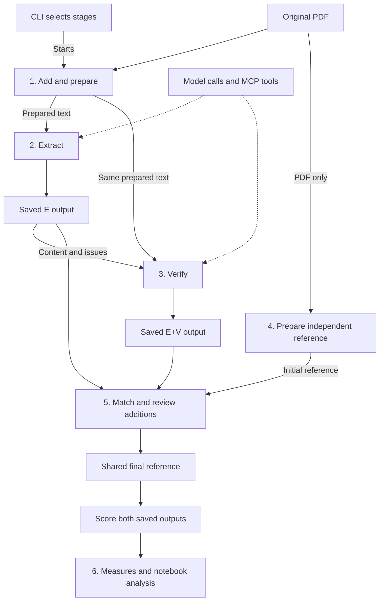

# Heat Adaptation LLM dataset

**Study design and technical implementation (draft)**

**Last updated:** 2026-10-31

This study will build and evaluate a workflow that pairs open weight large language models (LLMs) with heat adaptation experts to extract data from government plans. The main contribution is practical knowledge about building the workflow, model limitations, useful tools, and where expert intervention is needed. The dataset is also an important output and may support future fine-tuning.

Sections 1 to 6 explain the study and processing steps. The appendix provides JSON field definitions, shared coding and repair rules, planned Python modules, and a worked example. This document describes proposed software; it does not mean the software has been built or tested.

## 1. Research questions and study design

The study asks:

1. How can experts and open weight LLM agents use Model Context Protocol (MCP) tools to build a structured extraction dataset?
2. How does adding a verifier change extraction quality, evidence quality, issues requiring review, and computational resources?

| Study set | Size | Purpose |
| --- | --- | --- |
| Development | 2 plans | Work openly through PDF preparation and the complete workflow; inspect outputs, fix problems, and adjust settings. |
| Comparison | 5 separate plans | Compare extractor outputs with and without verification against an independent expert reference. |
| Expansion | Later phase | Curate additional plans after the comparison works. The original ambition of 50 to 100 plans is outside the initial implementation. |

The comparison requires five independent references and ten output assessments. The size is based on workload. The study is exploratory; no statistical power calculation has been performed. Select plans with varied lengths, formats, and plan types, avoiding near copies of the same document. Fix the selection before comparison runs; report per plan findings and limit broader claims.

Each comparison plan produces two outputs:

- **Extractor (E):** The extractor reads the plan and returns records, supporting evidence, and issues.
- **Extractor + verifier (E+V):** A different model checks a copy of that exact extractor output against the source, corrects supported errors, reviews issues, and looks for omissions.

Both configurations share one extractor run. Verification reviews the entire extraction, including unflagged records. The comparison evaluates the tested workflow and model pair; it cannot isolate the effects of MCP, model family, or open weights.

For comparison plans, run and save E and E+V before experts create the initial reference. Experts fill the reference from the original PDF without viewing, copying, or using model outputs. Validate and save that reference before revealing outputs for assessment. Reference preparation is independent extraction; assessment is the later judgment of model outputs against that reference and the source. The experts who complete reference templates may differ from those who evaluate outputs. Assess both outputs before making corrections, and use the same extraction and scoring rules across participating experts. Expert IDs are not recorded.

### Which outputs count

For each plan, use the first successful comparison extractor run and the first successful comparison verifier run linked to it, under the fixed study settings. Successful means processing completed and the final output passed format checks. Expert assessment determines correctness separately.

Keep failed attempts. Retry manually after fixing the problem. A deliberate repeat of successful work is exploratory and does not replace the main comparison output. Do not select outputs based on expert scores.

Fix models, prompts, tools, document preparation, and scoring rules before comparison. Changes to these choices require a documented revision of the study setup; do not silently pool outputs from different setups.

## 2. Plans and extracted content

Experts screen documents before import. Eligible documents are final government or public agency plans that are publicly available in English, were published or updated in 2010 or later, and address heat adaptation directly or through a dedicated heat section with at least one heat action. Prioritize recent versions. The original PDF must be readable by a person and have stable PDF page numbers, including readable scans.

The software accepts prescreened documents without asking for eligibility confirmation.

Each output contains plan metadata and five content lists:

| List | What is extracted | Extraction question |
| --- | --- | --- |
| Goals | Stated goals, targets, and deadlines. | 1. What heat adaptation goals does the plan state, including any specific targets or deadlines? |
| Actions | Heat adaptation actions and implementation status. | 2. What actions does the plan propose or report taking to reduce heat-related risks? |
| Monitoring and evaluation | What is monitored or evaluated, how, and by whom. | 3. What monitoring or evaluation does the plan describe? |
| Benefits and impacts | Expected or reported outcomes, including adverse impacts. | 4. What benefits or impacts does the plan expect or report? |
| Costs and resources | Financial costs and other resource requirements. | 5. What costs or resource requirements does the plan report or estimate for its heat adaptation actions? |

Every content record includes quotations and PDF page references. Preserve what the source states, including qualifications, quantities, populations, and timing. Do not infer a goal solely from an action or interpret monitoring activity as proof of reduced heat risk. Appendix B defines the fields; Appendix E gives shared coding instructions for agents and experts.

## 3. Processing one document

| Step | What happens | What is saved |
| --- | --- | --- |
| 1. Add and prepare | Import the eligible PDF and collection details. Python prepares text by PDF page and records problems. | Registry entry, original PDF, page text, and preparation notes. |
| 2. Extract | Select an extractor profile. Supply the whole prepared document. The agent reads, uses tools when needed, and returns content and issues. | One extractor run file, model responses, and tool activity. |
| 3. Verify | Select the saved extractor run and a verifier profile. The verifier receives its content and issue list, plus the source. | One verifier run file with revised content and issues. |
| 4. Prepare the reference | After E and E+V, Python generates a blank reference template for comparison plans. Experts fill it from the original PDF without viewing model outputs, then validate and save it. | Independent initial expert reference. |
| 5. Assess | Python generates assessment templates. Experts match records, judge accuracy and evidence, and check claimed resolutions. | Completed assessments and a shared final reference. |
| 6. Analyze | Python calculates measures; notebooks compare E and E+V and summarize practical observations. | Analysis tables and figures. |

### Add the PDF and source details

Use a small CLI, or command line interface, to import a PDF with its title, official source URL, access date, and study set. Python assigns a document ID, saves the PDF, and checks its SHA-256 checksum, a fingerprint of the file contents, for duplicates.

Collection details can be edited later without importing the PDF again. Keep the metadata used by completed runs unchanged. Correct collection metadata for future work and note meaningful corrections in the change log when requested.

A revised published PDF gets a new document ID. Renaming or copying the same PDF does not create a new document. Never replace the registered PDF with different contents.

### Prepare text automatically, investigate gaps with tools

Python prepares page text before model processing. The extractor does not need to request routine preparation page by page.

Preparation has three states:

- **Ready:** Automatic checks found no problems.
- **Ready with gaps:** Some text is unavailable or unreliable, but the PDF can be inspected with tested image or OCR tools.
- **Failed:** The PDF cannot be opened, its pages cannot be identified, or no usable reading route is available. Fix this before processing.

OCR, or optical character recognition, converts text in images into machine readable text. Agents can request page images or OCR to investigate tables, garbled text, or missing passages. Preserve unresolved gaps as issues. Unreadable material is not evidence that information is absent.

Save the exact initial page text and preparation notes used by runs. New preparation goes in a new folder; earlier runs keep their original source path. Images and OCR requested by an agent are saved with that run and do not overwrite initial page text.

### Use the whole document

Supply the full prepared text with PDF page numbers, instructions, and field definitions. Verification also receives the saved extractor content and issues. Check that each request fits the model's context limit, the amount of information it can process at once, including room for responses and tool results.

If it does not fit, stop and report the problem. Adjust the model or settings during development. Do not silently truncate the document or switch to page groups.

### Run, retry, and inspect status

Process one document at a time initially. The CLI lists registered documents and their preparation, extraction, and verification status.

Select profiles explicitly. To verify or retry verification, select the exact successful extractor run. Verification uses the same prepared source path as that run. Completed work is read from its saved file; the software does not search automatically for equivalent runs.

**JSON validation and repair.** A Python module checks the final response, reports syntax, structure, reference, or other errors, and applies only the permitted format repairs in Appendix F. It preserves the original response, records each repair, and validates the result again. Repairs happen within the same run without another model call. Missing fields and other errors outside the repair rules are reported and left unchanged; any remaining validation error fails the run.

A failed model request or unhandled error also ends that run. Recoverable source problems stay in the issue list. Stop on failure, retain available responses and measurements, and retry manually with a new run ID. There are no automatic retries or retry count settings.

If verification fails, the successful E output remains available. Retry only verification using the same saved extraction. If a process is interrupted, confirm it has stopped before marking it failed; do not invent an elapsed duration from the later recovery time.

Completed files remain unchanged. Save expert corrections separately after assessment. If inputs or settings change, start new work and label it appropriately. Missing or damaged saved inputs must be restored or recreated explicitly before use.

### Simple issue handling

Keep one issue per affected record, describing its problems together. For an omission, empty category, or source gap, describe the distinct item or problem and cite affected pages. Keep the same issue ID when the verifier adds a previously missing record.

Each issue has a description, optional type, origin stage, open/resolved status, and resolution explanation. Keep every extractor issue in the verifier output, including already resolved ones. Add new verifier issues with new IDs.

Resolve an issue only when all its concerns are addressed or source checking establishes that correction is unnecessary. A justified confirmation of absence can resolve uncertainty without correcting an error. Correctly unspecified source details alone do not create issues. Check empty categories before accepting absence.

Open issues remain for expert review. Source recovery happens within the agent's tools or through an explicit later rerun; it does not need a separate routing system. Keep tool activity in the run log and compare the saved E and E+V issue lists. No separate concern or event history is required.

## 4. Python system, settings, and saved files

### Responsibilities

| Part | Responsibility |
| --- | --- |
| Python modules | Prepare documents, call models and tools, validate responses and apply permitted format repairs, save files, generate expert templates, and calculate measures. |
| CLI | Select documents, profiles, and input runs; start work; edit collection details; import expert files; and show status, validation errors, and repairs. |
| Notebooks | Inspect outputs and produce research analysis using the shared Python modules. |
| LLM agents | Interpret source text, request tools, and return extracted content and proposed issues. |
| Experts | Prepare references, assess outputs, decide correctness, and explain practical lessons. |

An agent is a model used in a loop: read instructions, request a tool if needed, inspect the result, and submit an answer. Python runs the loop and executes tool requests. MCP provides a standard connection to the document tools. Start the MCP server locally and connect through the Python process's standard input and output.

Both agents have access to the same PDF, prepared text, and tool capabilities. For comparison plans, expert references and assessments are created after agent processing. They stay outside agent access, including during any later reruns. Treat document text as source evidence, not instructions to the agent.

Start with tools for reading page text, rendering page images, OCR, and locating quotations with surrounding text. A quotation match checks wording, not whether it supports the claim. Python validates final JSON automatically. Save tool arguments, results or file paths, durations, and failures in an ordered log; separate tool or artifact IDs are unnecessary.

### Workflow

The CLI selects and starts each stage. Numbers show processing order; solid arrows show inputs and saved outputs. Dashed arrows show shared model and MCP tool support. Reference preparation starts only after E and E+V are saved, and uses the original PDF with model outputs hidden.



Step 5 matches both saved outputs to the initial reference, reviews additions and corrections, and scores both against one shared final reference. Appendix G maps these stages to Python modules: shared validation and storage, model response repair, and measures used by notebooks.

Until the initial reference is saved, comparison run feedback shows status, error categories, and report paths, keeping extracted claims, issues, response snippets, and repair details hidden. Reference authors must not inspect the saved model files. If troubleshooting requires viewing them, experts who have not seen those outputs must prepare the reference. Development permits open inspection.

### Models and profiles

Start locally with Ollama on the Apple M5 Pro MacBook with 64 GB of memory. The provisional candidates remain:

| Role | Candidate | Ollama tag |
| --- | --- | --- |
| Extractor | Qwen3.5 27B | `qwen3.5:27b` |
| Verifier | Gemma 4 31B | `gemma4:31b` |

Test memory use, full document capacity, tool calls, structured JSON, and image/OCR support on the development plans. Load models sequentially. These candidates may change with observed performance or a move to hosted APIs. Different model families can still share errors.

Later, explore Hugging Face hosted APIs if needed. Keep the workflow and MCP tools local; send the required source text and tool results to the selected provider. Use the same output format. Hosting is a development choice, not another experimental configuration. Hosted availability and capabilities must be tested.

Keep named extractor and verifier profiles in one editable `configs/profiles.json` file. Add a profile by copying an entry, giving it a new name, and changing its settings. Select names through the CLI. Python saves the complete settings and prompt text inside each run, so later profile edits cannot alter earlier results.

A profile specifies the model and endpoint, generation and context settings, prompt files, tool call limit, and image/OCR settings. Python adds detected model and software versions, hardware, and the Git commit. Appendix A defines these fields. At the tool call limit, request a final answer and leave unresolved issues open; output that remains invalid after permitted repairs still fails the run. This limit is separate from manual retries.

### Files and identifiers

Save one `output.json` per extractor or verifier run. It contains run details, content, and review together. A verifier's `input_run_id` identifies the entire extractor output, including its issues. This replaces separate extraction and review versions and their reuse checks.

| Identifier | Purpose |
| --- | --- |
| `plan_id` | One registered document version. |
| `run_id` | One extractor or verifier execution. Every retry or repeat gets a new ID. |
| Record ID | One content item, such as `action_0001`. Keep it for a continuing item; give additions new IDs. |
| `issue_id` | One issue followed from extraction through verification. |

Record and issue IDs are local to a document's linked outputs. Expert reference IDs are matched to model records by meaning. References and assessments use descriptive file paths and configuration labels instead of additional IDs.

When verification removes or splits a record, the verifier must update all affected links and issues in its output. Keep the original ID for a continuing item and give new items new IDs. Remove deleted IDs from link lists and make replacement links only where supported by the source. Python checks the revised IDs and links before accepting the output.

Retain baseline issue IDs. If an issue's record is removed, set `related_record_id` to null and name the removed record in the description. If an issue affects several resulting records, link it to one and name the others in the description.

A proposed layout is:

```text
data/registry/plans.json                           # Registered documents and collection details.
data/raw/plan_0001.pdf                              # Original PDF.
data/processed/plan_0001/preparation_01/source.json  # Source metadata and preparation status.
data/processed/plan_0001/preparation_01/pages.json   # Page text and preparation problems.
configs/profiles.json                              # Named model, prompt, and tool settings.
runs/plan_0001/run_extract_0001/output.json          # Extractor records, issues, settings, and measurements.
runs/plan_0001/run_extract_0001/responses/           # Raw model responses.
runs/plan_0001/run_extract_0001/tool_log.json        # Tool requests, results, durations, and errors.
runs/plan_0001/run_extract_0001/validation_report.json # Final-response checks, repairs, and remaining errors.
runs/plan_0001/run_verify_0001/output.json           # Verifier records, issues, settings, and measurements.
runs/plan_0001/reference_initial.json               # Expert reference prepared after E and E+V, without viewing outputs.
runs/plan_0001/reference_final.json                 # Shared revised reference and reasons for changes.
runs/plan_0001/assessment_e.json                    # Expert judgments of the extractor output.
runs/plan_0001/assessment_ev.json                   # Expert judgments of the verified output.
```

Preparation folders and run folders preserve their inputs. They do not need separate source, snapshot, review, batch, or result IDs. Assessment drafts use separate working files; retain earlier completed assessments if revised.

Keep modules in `src/`, notebooks in `notebooks/`, and specifications, prompts, and settings in `schemas/`, `prompts/`, and `configs/`. Track these, registry metadata, and project documents in Git. Keep `AGENTS.md` local. Exclude credentials, PDFs, prepared text, model weights, and generated runs; back up excluded research files. Release packaging is a later decision.

## 5. Expert assessment and measures

### Complete the reference and assessments

1. After E and E+V have run, Python generates a blank initial reference template for a comparison plan with collection metadata and empty content lists. Do not prefill it from agent records or issues. Experts fill it from the original PDF without viewing model outputs, then validate and save it.
2. Only after the initial reference is saved, Python generates one assessment template for E and one for E+V. It fills known run links, quotations, page references, and relevant issues. Experts can now view the outputs and supply semantic matches and judgments.
3. Match outputs against the initial reference to identify additional items. Review additions and reference corrections, then save one shared final reference. Preserve the initial reference and explain each revision.
4. Score both outputs against that final reference. An item counts as additional only relative to the initial reference. Complete evidence and resolution checks, validate the files, and calculate measures.

Python checks format, links, and assessment coverage. Experts establish meaning, source support, and correctness. A supported addition is distinct source information missing from the initial reference. Group duplicate or split descriptions of the same addition once.

Pending judgments remain null and are not scored zero. Complete review covers every final reference item, supplied quotation and page reference, and claimed initial issue resolution. Failed runs without usable output have no quality score.

### Measures before expert assessment

Python calculates these from saved run files.

| Category | Measure | Calculation |
| --- | --- | --- |
| Operational performance | Successful processing runtime | E: successful extractor duration. E+V: that same duration plus successful verifier duration. Exclude failed attempts, time between attempts, initial preparation, and human review. |
| Operational performance | Tokens used | Sum input and output tokens across all model calls within the selected successful stages. Report input, output, and total separately. |
| Operational performance | Failed executions | Count distinct failed extractor and verifier run IDs in the comparison work, including retries. Report by stage; shared extraction failures count once. |
| Evidence quality | Records with quotations | Number of output records with at least one quotation listed. |
| Verifier and review outcomes | Initially open issues | Count open issues in the shared extractor output. |
| Verifier and review outcomes | Initial issues marked resolved | Count initially open issues marked resolved by the verifier. |
| Verifier and review outcomes | Issues remaining for expert review | Count all open issues in each output. |
| Verifier and review outcomes | New verifier issues | Count issue IDs in the verifier output absent from the extractor output, including new issues the verifier resolves. |

Python counts records with quotations across the five output lists, once per record when at least one nonempty quotation is listed. This counts quotation presence without judging validity. Records without quotations do not count.

Measure each stage from start to finish, including loading initiated within the stage, model requests, agent requested tools, validation, and permitted format repairs. Hosted duration includes network and provider waits. Record whether a model was already loaded. Include model calls made by OCR tools in token counts. Missing required duration or usage data makes the relevant total null.

For example, extraction taking 100 seconds, a failed verification taking 30 seconds, and a successful verifier retry taking 60 seconds give E runtime of 100 seconds and E+V runtime of 160 seconds. Retain the failed attempt's measurements in its run file and count the failure. This runtime describes successful processing, not total effort including failures. A failed E+V process has no successful E+V runtime; its successful E output can still be reported.

### Correctness scoring

Match model records to expert reference records by meaning. Different wording is acceptable.

| Score | Meaning |
| --- | --- |
| 1 | All required substantive information is correct, with no unsupported substantive additions. |
| 0.5 | Some substantive information is correct, but at least one required part is wrong, missing, or unsupported. |
| 0 | No substantive information is correct, or the reference record is omitted. |

For example, a correctly identified action with an incorrect implementation status scores 0.5. Correctly recording that the source does not specify a detail does not reduce the score. Assess evidence separately from content.

Count each reference item once. A split output may need several records to cover one reference item; a combined output may cover several reference items. Duplicates earn no extra credit.

### Measures after expert assessment

| Category | Measure | Calculation |
| --- | --- | --- |
| Extraction quality | Partial credit record rate | Sum reference record scores ÷ number of final reference records × 100. |
| Extraction quality | Fully correct record rate | Reference records scored 1 ÷ all final reference records × 100. |
| Extraction quality | Additional record count | Number of distinct additional items compared with the initial reference. |
| Extraction quality | Supported additional record percentage | Additional items judged supported ÷ all additional items × 100. |
| Evidence quality | Valid quotation percentage | Supplied quotation uses judged to support their assigned claims ÷ all supplied quotation uses × 100. |
| Evidence quality | Page reference correctness | Correct cited pages ÷ all cited pages assessed across quotation uses × 100. |
| Verifier and review outcomes | Expert confirmed initial resolutions | Count initially open issues the verifier marked resolved whose resolution experts judge justified. Report alongside the number claimed resolved. |

For ten reference records with six fully correct, two partial, and two omitted, the partial credit record rate is 70% and the fully correct record rate is 60%. Both come from the same expert scores.

The quality denominator counts records across the five reference lists. Metadata, evidence objects, individual targets, and issue descriptions are not separate records. Unsupported additional items do not lower a reference based score, so always report additional record count and support percentage alongside the record rates.

Check each quotation against the claims it is used to support and each cited page separately. A repeated quotation in different records counts as separate uses. Missing evidence is an extraction problem; quotation percentages describe evidence actually supplied.

### Reporting and interpretation

Keep E and E+V paired by plan. Report per plan results and underlying counts. Treat overall summaries as descriptive. The proposed overall summary is the mean of valid per plan percentages, with the number of contributing plans; confirm this after the development assessment. Zero denominators are not applicable, not zero. Pending checks make the corresponding final measure unavailable until completed.

Interpret findings within the small comparison set and the participating experts' judgments. Different outputs may share errors, and the expert reference can also require correction. Saving the initial reference and shared revisions makes those changes visible.

Issue counts are indicators of review workload. They do not measure expert review time. Issues marked resolved by the verifier are claims; expert confirmation and changes in extraction quality establish whether the verifier helped.

Deferred analyses are issue and referral percentages by type, a genuine issue rate across all flags, and a separately coded count of unflagged problems. Optional issue types may still be saved. Detailed results by content category can be calculated later from the same record scores.

## 6. Implementation order and remaining decisions

Build and test in this order:

1. Document registration and page preparation.
2. One complete local extractor run with saved content, issues, settings, responses, and measurements.
3. Verification of that exact output, with the same source and tool access.
4. Blank reference and expert assessment templates, validation, and calculation of the agreed measures.
5. Comparison notebooks and practical research reporting.

Use the two development plans as an open, iterative process. Start with a straightforward PDF, then try a plan with more difficult tables, layout, or scanned pages where available. Compare prepared text and page numbers with the original PDF. Inspect model outputs and tool results openly, adjust preparation, prompts, models, or tools, and repeat runs with new IDs as needed.

Check that extraction, verification, JSON repairs, saved files, and measurements work together. Use selected expert coding and assessment examples to check the templates and calculations; complete independent references are not required for both development plans. Keep development runs outside the comparison and fix the study settings before starting it.

Remaining development choices are model suitability and quantization, full document capacity, image/OCR support and software, tool call limits, and the overall summary rule. Hosted APIs remain an option. Expansion, release format, redistribution permissions, and storage for published artifacts can be decided later.

Retain short observations about model limitations, useful tools, failures, and necessary expert intervention. Record expectations separately from observed results. Use the existing change log when entries are requested. These observations support the practical contribution; a larger software tracking system is unnecessary.

## Appendix: JSON fields, rules, and example

A schema defines allowed fields, types, and values. The following definitions guide implementation; validators and templates will be created when coding is authorized.

Use JSON objects for records and lists for multiple items. Dates use `YYYY-MM-DD`, timestamps use UTC, durations use seconds, and paths are relative to the project root. Use `[]` for empty lists, `null` for unavailable nullable values, and the defined enum value such as `not_specified` where required. An enum is a fixed set of permitted values.

All fields listed below are required unless marked optional. Unknown final fields and invalid values fail validation unless corrected by a permitted format repair in Appendix F. IDs and paths must resolve, and page numbers must be within the original PDF's page range.

### A. Registry, source, profiles, and run details

**Registry.** `data/registry/plans.json` contains `schema_version: 1` and a `plans` list. Each entry has `plan_id`, `plan_title`, `pdf_path`, `document_sha256`, `source_url`, `date_accessed`, `study_set`, and `prepared_source_path`. These are strings, except `prepared_source_path` may be null until preparation. Study set is `development`, `comparison`, or `expansion`. Development plans stay outside comparison.

**Prepared source.** Each `source.json` contains `schema_version` (integer), `plan_id`, `pdf_path`, `document_sha256`, `source_url`, `date_accessed`, `prepared_at` (timestamp), `pages_path`, `page_count` (positive integer or null on failure), `status` (`ready`, `ready_with_gaps`, or `failed`), and `problem` (string or null). The other fields are strings. The PDF checksum is a 64 character hexadecimal SHA-256 value.

The linked `pages.json` is an ordered list with `page_number` (positive integer), `text` (string or null), `readable` (Boolean), `image_available` (Boolean), and `problem` (string or null). Include every known PDF page once. An empty string denotes a known blank page; null denotes unavailable text. If opening or counting fails, use null page count and an empty list. Processing an image only PDF requires a tested image or OCR route.

**Profiles.** `configs/profiles.json` contains `schema_version: 1` and a `profiles` list. Each entry has:

| Field | Type and meaning |
| --- | --- |
| `name`, `stage` | Strings; unique readable name and `extractor` or `verifier` stage. |
| `model` | Object: `name`, `execution_mode` (`local` or `hosted_api`), `endpoint`, `api_service`, and `provider`. All strings; service and provider nullable locally. |
| `generation` | Object: `temperature` (nonnegative number or null), `top_p` (number greater than 0 and at most 1, or null), `seed` (integer or null), and `max_output_tokens` (positive integer). |
| `context_limit` | Positive integer; tested model context setting. |
| `prompt_paths` | Nonempty ordered list of instruction file paths. |
| `max_tool_calls` | Positive integer limiting tool calls within a run. |
| `tools` | Object: `image_input_enabled` and `ocr_enabled` (Booleans), `image_render_dpi` (positive integer), `ocr_engine` and `ocr_language` (strings or null when disabled). Render images as PNG. |

Only send supported settings; retain unsupported generation controls as null. Test image input on the actual model and serving setup before enabling it for both agents.

**Run file.** A completed run's `output.json` contains:

| Field | Type and meaning |
| --- | --- |
| `schema_version` | Integer, initially 1. |
| `plan_id`, `run_id` | Strings identifying the document and execution. |
| `stage` | `extractor` or `verifier`. |
| `purpose` | `development`, `comparison`, or `exploratory`. |
| `input_run_id` | Successful extractor run ID for verification; null for extraction. |
| `retry_of_run_id` | Failed run being retried, or null. |
| `source_path` | String linking to the preserved prepared source. |
| `status` | `running`, `succeeded`, or `failed`. |
| `started_at`, `ended_at` | UTC timestamps; end nullable while active. |
| `elapsed_seconds` | Nonnegative number or null if unavailable. |
| `settings` | Complete selected profile, prompt text in `prompt_texts` (ordered list of strings), and detected `environment` details below. |
| `model_calls` | Ordered list with `input_tokens`, `output_tokens` (nonnegative integers or null), and `response_path` (string or null). |
| `tool_log_path` | String or null if no tools were called. |
| `content` | Appendix B object; null if no valid final content was produced. |
| `review` | Object with `issues` list from Appendix C; null if no valid final review was produced. |
| `error` | Failure explanation string, or null. |

The environment records `model_revision`, `runtime`, `runtime_version`, `quantization`, `hardware`, `code_commit`, `python_version`, `model_client_version`, `preparation_version`, `tools_version`, and `ocr_version` as strings or null when unavailable, plus `code_dirty` (Boolean) and `model_loaded_at_start` (Boolean or null). Use clean committed code for the formal comparison. Unknown hosted deployment details remain null. Exclude credentials from saved settings.

A tool log is an ordered list with `tool` (name), `arguments` (object), `result` (object or null), `elapsed_seconds` (number or null), and `error` (string or null). Results identify original page numbers and saved file paths where relevant. Save actual image/OCR settings and generated files with the run. Large responses can be linked by path.

Agents return one object containing `content` and `review`. The verifier returns the complete revised content and issue list. Python supplies run metadata and measurements, checks IDs and links, and saves the combined file. ID normalization may consistently rename valid local IDs and their existing links; it must preserve continuing record and issue IDs across verification. It cannot guess missing targets, create relationships, or repair broken references; those remain validation errors under Appendix F. Expert files use the same content structure without simulated model runs.

### B. Extracted content

`content` contains `plan_info` and the five lists: `plan_goals`, `plan_actions`, `plan_mon_eval`, `plan_benefits`, and `plan_costs`.

**Plan information.** `plan_info` contains `plan_title`, `jurisdiction_name`, `country`, `plan_scale`, `plan_type`, `publication_year`, `lead_agencies`, `source_url`, `date_accessed`, and `language`. All are strings except year (integer or null) and agencies (list of strings). Title, jurisdiction, country, scale, and type may be null if unavailable. Scale is `city`, `county`, `region`, `state`, or `country`; type is `heat_specific_plan` or `broader_climate_plan`. Source URL and access date come from collection; language is English.

**Evidence.** Every record has an `evidence` list of objects containing `quote` (string) and `page_numbers` (nonempty list of unique positive integers). Each quote is an exact continuous passage and may span pages. Count the first PDF page as 1, regardless of printed labels. Multiple passages use separate evidence objects.

Use OCR to recover visible text, labels, and written values from scans, tables, charts, and diagrams. Check recovered wording and numbers against the page image before quoting them, and cite the original PDF pages. Use separate evidence objects for separate passages, including headings or footnotes needed to understand a value. Flag unreadable or uncertain material as an issue; do not turn a generated visual description into a quotation. Flag missing or unsupported evidence and exclude unresolved material from a curated release.

**Goals.**

| Field | Type and rule |
| --- | --- |
| `goal_id` | String, such as `goal_0001`. |
| `goal` | String describing the stated goal, including relevant population and geography. |
| `targets` | List of objects with `target` (string) and `deadline` (string or null). |
| `evidence` | List of evidence objects. |

Pair each target with its deadline. Preserve quantities, units, baselines, and the precision of timing. Targets may be qualitative. Do not infer goals solely from actions or benefits.

**Actions.**

| Field | Type and rule |
| --- | --- |
| `action_id` | String, such as `action_0001`. |
| `action` | String beginning with an action verb; include stated implementers, populations, locations, quantities, and timing. |
| `action_status` | `planned`, `in_progress`, `completed`, `discontinued`, or `not_specified`. |
| `related_goal_ids` | List of explicitly associated goal IDs. |
| `evidence` | List supporting the action, status, and links. |

Planned means proposed or committed without evidence work has begun; in progress means underway or functioning; completed means finished; discontinued means stopped or withdrawn. Use not specified when the source does not establish status. Issuing a plan does not establish responsibility for each action.

Combine repeated mentions of the same action. Split distinct actions into separate records, even when they appear in one statement. Keep each action's stated details with that action. Appendix E gives examples.

**Monitoring, benefits, and costs.** All three have `scope`, `related_goal_ids`, `related_action_ids`, and `evidence`, plus these fields:

| List | ID field | Description field and content |
| --- | --- | --- |
| `plan_mon_eval` | `mon_eval_id` | `mon_eval`: indicators, methods, frequency, responsibility, and reporting where stated. |
| `plan_benefits` | `benefit_id` | `benefit`: outcomes, quantities, affected groups, comparisons, timing, and qualifications. |
| `plan_costs` | `cost_id` | `cost`: amounts, currency/units, periods, and recurring or one-off character. |

IDs and descriptions are strings; link fields are lists of strings. Scope is `linked` when at least one explicit goal/action link exists, `plan_wide` for an explicitly overall plan/programme statement with no specific links, or `unspecified` when scope is unclear and both link lists are empty. Unspecified scope alone does not create an issue.

Distinguish expected, modelled, and observed benefits. Distinguish cost estimates, allocations, expenditure, and needs. Record shared budgets once and link applicable actions. Do not convert currencies or divide amounts without source support.

### C. Issues

Each issue has:

| Field | Type and meaning |
| --- | --- |
| `issue_id` | String, stable through verification. |
| `related_record_id` | String or null for an omission, category, source problem, or removed record. |
| `description` | String describing the grouped problems or uncertainty; identify categories/pages for problems without a record. |
| `type` | Optional string or null: `unclear_meaning`, `conflicting_evidence`, `source_issue`, `extraction_process_issue`, or `no_records_found`. |
| `origin_stage` | `extractor` or `verifier`. |
| `status` | `open` or `resolved`. |
| `resolved_by` | `extractor`, `verifier`, or null while open. |
| `resolution` | Explanation string for a resolution, or null while open. |

Use one issue for several problems in one record. Retain all baseline IDs and origin stages in verification, even if an issue is reopened. Update explanations without erasing the original saved extractor file. New issues get new IDs. An issue is resolved only if all grouped problems are addressed.

### D. Expert files

A reference file contains `schema_version`, `plan_id`, and `content` using Appendix B. Keep `reference_initial.json` unchanged. `reference_final.json` additionally contains `revisions`, a list with `record_ids`, `reason`, and `evidence` for corrections and supported additions. Reference record IDs remain stable where the item is unchanged. If a completed final reference needs another revision, save a new named file and update both assessments to use it, preserving the earlier files.

An assessment contains `schema_version`, `plan_id`, `configuration` (`extractor_only` or `extractor_verifier`), `run_id`, `initial_reference_path`, `final_reference_path` (nullable while draft), `status` (`draft` or `complete`), `completed_at` (timestamp or null), and these lists:

| List | Fields in each item |
| --- | --- |
| `initial_matches` | `reference_record_id` and `output_record_ids` (list; empty for an omission). |
| `record_scores` | `reference_record_id`, `output_record_ids`, `score` (0, 0.5, 1, or null while pending), and `reason`. One row per final reference item. |
| `additional_records` | `description`, `output_record_ids`, `support_status` (`supported`, `unsupported`, or `undetermined`), `final_reference_record_ids` (list), `reason`, and `evidence`. One row per distinct addition. |
| `quotation_checks` | `record_id`, `evidence_index` (zero based list position), `claim_fields` (nonempty list of fields the quotation is used to support), `supports_claim` (Boolean or null), `page_checks` (list of `page_number` and `correct` Boolean or null), and `reason`. |
| `resolution_checks` | `issue_id`, `justified` (Boolean or null), and `reason`. One row per initially open issue marked resolved by the verifier; empty for E. |

IDs, descriptions, paths, and reasons are strings; plural ID fields are lists. Evidence follows Appendix B. Experts assign matches and which claims each quotation is used to support. Python prefills known identifiers, evidence lists, and pending rows, but does not assign meaning or scores. Support is true only if all assigned claims are supported. Check each cited page independently.

An omitted reference item has no output IDs and scores 0 once assessed. Undetermined support and null judgments are pending. Validate all required coverage before marking an assessment complete. Save revised completed assessments separately; analysis uses the explicitly selected assessment files.

### E. Shared coding instructions

Agents and experts use these rules when extracting records or completing the reference. Apply them with the field definitions in Appendix B.

| Topic | Rule |
| --- | --- |
| Heat relevance | Extract information explicitly connected to heat adaptation. Include actions explicitly intended in the plan to reduce heat risk or its impacts. A clear heat-specific heading can establish this context. Do not infer heat relevance from general climate, greening, or health measures. |
| Separate actions | Record one distinct action per record. Split "plant trees and install drinking fountains" into two actions. Keep quantities, locations, implementers, and timing with the relevant action. |
| Repeated information | Combine repeated descriptions of the same item and retain the evidence needed for its details. Different wording alone does not create another record. Flag conflicting source statements rather than choosing one without explanation. |
| Goals and targets | Record stated goals, not goals inferred from actions. Pair each target with its stated deadline, preserving quantities, units, and baselines. |
| Detail and status | Preserve qualifications, conditions, populations, geography, responsibility, and timing where stated. Code status as reported in the document; a past deadline does not establish completion. Use `not_specified` when status is not established. |
| Links and scope | Link records only where the source explicitly associates them through wording, headings, or table structure. Use `plan_wide` for an explicitly overall statement without specific links and `unspecified` when scope is unclear. Do not assign responsibility solely because an agency issued the plan. |
| Monitoring, benefits, and costs | Keep monitoring activity separate from evidence of reduced heat risk. Preserve whether benefits are expected, modelled, or observed, and whether costs are estimates, allocations, expenditure, or needs. Record shared budgets once; do not invent allocations or convert amounts. |
| Quotations and OCR | Quote visible source text and numbers, including OCR recovered from visuals and checked against the page image. Include headings or footnotes needed to understand them. Cite original PDF page numbers, starting at 1. Do not present an inferred visual description as a quotation. |
| Missing information | Use `null`, `not_specified`, or empty lists as defined in the schema. Check empty categories before accepting absence. Unreadable material is a source gap, not proof of absence. Keep unresolved gaps or uncertainty as issues. |

### F. JSON validation and repair rules

Apply the same fixed rules to extractor and verifier final responses. Fix the rules before comparison. Repairs may change formatting, but must preserve wording, factual values, and meaning. They do not add another model call or run ID.

Report detected errors as `syntax` when JSON cannot be read, `structure` when fields, types, or values violate the schema, `reference` when IDs, paths, or page references are invalid, or `other` for another validation failure. Show the line and column or field path where available, with a plain-language explanation. A syntax error may prevent later checks until it is repaired.

Apply only these repairs, in the listed order:

| Case | Rule |
| --- | --- |
| JSON code fence | Remove a Markdown code fence only when it encloses the entire response and contains one JSON answer without surrounding commentary. |
| Trailing comma | Remove a comma immediately before a closing brace or bracket, outside quoted text. |
| Missing closing brace or bracket | Append missing closing delimiters only at the end, after a complete value, when the required nesting is unambiguous and generation ended normally. Do not complete cut-off responses, unfinished strings, or missing values. |
| Single page number | Convert a positive integer in `page_numbers` to a one-item list, such as `12` to `[12]`. Check the page range afterward. Do not interpret text or guess page numbers. |
| Missing field | Leave it missing and report a structure error. Do not insert `null`, `not_specified`, an empty list, or invented content. |
| Other or ambiguous error | Leave it unchanged and report it. Do not guess values, change quotations, remove records or unknown fields, or repair broken references. |

Preserve the raw response. Save any repaired candidate separately as `responses/repaired_final.txt`, then repeat all format and reference checks. A run succeeds only if the final candidate passes every check. Otherwise, save the available files and fail the run. A repaired response that passes is part of the successful run; initial format errors are reported but do not count as a separate failed execution. Expert assessment still determines correctness.

When final-response validation is attempted, save `validation_report.json` in the run folder with `raw_response_path`, `repaired_response_path` (null if unchanged), `initial_errors` and `remaining_errors` (lists of errors), `repairs` (list), and `valid` (Boolean). Each error has `category`, `location` (string or null), and `message`. Each repair has `rule`, `location`, `before`, and `after`, recorded as strings. Paths and other text fields are strings. The CLI shows the repairs, remaining errors, and report path, subject to Section 4's restrictions on comparison feedback before reference preparation is complete. On failure, the run's `error` field summarizes the remaining problem.

### G. Planned Python modules

A module is a Python file containing related functions. These proposed files belong in `src/`; they have not been implemented. Stage numbers refer to section 3.

| Module | Stage | Responsibility |
| --- | --- | --- |
| `cli.py` | 1 to 6 | Handle commands, select documents, profiles, and input files, and show status, errors, and repairs. Call the shared modules. |
| `documents.py` | 1 | Register PDFs and collection details, check duplicate checksums, prepare page text, and record preparation problems. |
| `agents.py` | 2 and 3 | Load the selected profile and prompts. Run extraction or verification, check context and tool limits, request tools, and validate and save the final output. |
| `models.py` | 2 and 3 | Connect to Ollama or a hosted provider. Send model requests, images, and tool messages; return raw responses and usage measurements. |
| `document_tools.py` | 2 and 3 | Expose the local MCP tools for page text, images, OCR, and quotation lookup. Restrict access to the selected source and permitted run artifacts. |
| `validation.py` | Shared | Check JSON syntax, required fields, types, IDs, links, page ranges, and assessment coverage. Classify errors; for model final responses, call `repair.py` and validate again. |
| `repair.py` | 2 and 3 | Apply only the format repairs in Appendix F. Return the repaired text and details of each change for the validation report. |
| `expert_files.py` | 4 and 5 | Generate blank references and assessment templates in the agreed order, and import completed expert files. Experts supply matches and judgments. |
| `metrics.py` | 6 | Calculate the agreed measures from selected run and assessment files, and export analysis tables. |
| `storage.py` | Shared | Allocate IDs, preserve inputs and completed files, and save runs, raw responses, logs, reports, and status. |

Notebooks in `notebooks/` use `metrics.py` to compare E and E+V and produce tables and figures. Keep calculation rules in the module so the CLI and notebooks use the same functions.

### H. Compact run example

This fictional extractor output has one action and one bundled issue. The quote says the action is planned and gives a quantity and deadline; the extraction wrongly says completed and omits those details. That action would receive partial credit. Empty lists illustrate structure, not a complete plan.

The model revision, software versions, settings, timings, and tokens are illustrative placeholders. No referenced files have been created.

```json
{
  "schema_version": 1,
  "plan_id": "plan_0001",
  "run_id": "run_extract_0001",
  "stage": "extractor",
  "purpose": "comparison",
  "input_run_id": null,
  "retry_of_run_id": null,
  "source_path": "data/processed/plan_0001/preparation_01/source.json",
  "status": "succeeded",
  "started_at": "2026-10-31T12:00:00Z",
  "ended_at": "2026-10-31T12:00:30Z",
  "elapsed_seconds": 30,
  "settings": {
    "name": "local_extractor_v1",
    "stage": "extractor",
    "model": {
      "name": "qwen3.5:27b",
      "execution_mode": "local",
      "endpoint": "http://localhost:11434",
      "api_service": null,
      "provider": null
    },
    "generation": {
      "temperature": 0,
      "top_p": null,
      "seed": null,
      "max_output_tokens": 8192
    },
    "context_limit": 32768,
    "prompt_paths": ["prompts/extractor.md"],
    "max_tool_calls": 10,
    "tools": {
      "image_input_enabled": false,
      "ocr_enabled": false,
      "image_render_dpi": 150,
      "ocr_engine": null,
      "ocr_language": null
    },
    "prompt_texts": [
      "Extract stated heat adaptation records with source quotations and PDF page numbers. Flag uncertain or incomplete records. Return content and review."
    ],
    "environment": {
      "model_revision": "illustrative-model-revision",
      "runtime": "ollama",
      "runtime_version": "illustrative-version",
      "quantization": "illustrative-quantization",
      "hardware": "Apple M5 Pro, 64 GB memory",
      "code_commit": "illustrative-commit",
      "code_dirty": false,
      "python_version": "illustrative-version",
      "model_client_version": "illustrative-version",
      "preparation_version": "v1",
      "tools_version": "v1",
      "ocr_version": null,
      "model_loaded_at_start": true
    }
  },
  "model_calls": [
    {
      "input_tokens": 1024,
      "output_tokens": 256,
      "response_path": "runs/plan_0001/run_extract_0001/responses/response_01.json"
    }
  ],
  "tool_log_path": null,
  "content": {
    "plan_info": {
      "plan_title": "Example Heat Adaptation Plan",
      "jurisdiction_name": "Example City",
      "country": "Example Country",
      "plan_scale": "city",
      "plan_type": "heat_specific_plan",
      "publication_year": 2026,
      "lead_agencies": ["Example City Government"],
      "source_url": "https://example.org/heat-plan.pdf",
      "date_accessed": "2026-10-30",
      "language": "English"
    },
    "plan_goals": [],
    "plan_actions": [
      {
        "action_id": "action_0001",
        "action": "Plant trees around schools.",
        "action_status": "completed",
        "related_goal_ids": [],
        "evidence": [
          {
            "quote": "The city will plant 5,000 trees around schools by 2030.",
            "page_numbers": [1]
          }
        ]
      }
    ],
    "plan_mon_eval": [],
    "plan_benefits": [],
    "plan_costs": []
  },
  "review": {
    "issues": [
      {
        "issue_id": "issue_0001",
        "related_record_id": "action_0001",
        "description": "Check the status and restore the quantity and deadline.",
        "type": "extraction_process_issue",
        "origin_stage": "extractor",
        "status": "open",
        "resolved_by": null,
        "resolution": null
      }
    ]
  },
  "error": null
}
```

Verification reads this complete saved output. Its run file sets `stage: verifier` and `input_run_id: run_extract_0001`, then saves its full revised `content` and `review` alongside its own settings and measurements. For a supported correction, `action_0001` remains the same record ID and `issue_0001` remains the same issue ID; its status becomes resolved with a source based explanation.
