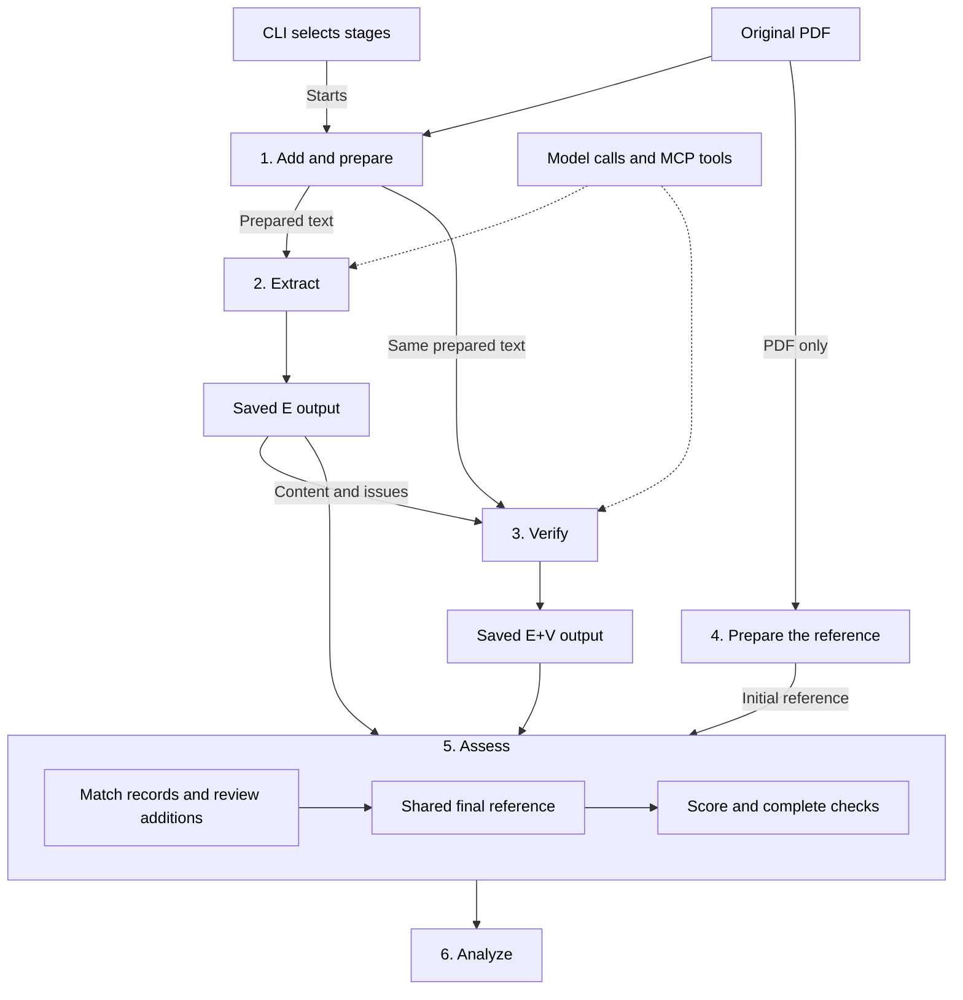

# Heat Adaptation LLM dataset

**Study design and technical implementation (draft)**

**Last updated:** 2026-11-04

This study will build and evaluate a workflow that pairs open weight large language models (LLMs) with heat adaptation experts to extract data from government plans. The main contribution is practical knowledge about building the workflow, model limitations, useful tools, and where expert intervention is needed. The dataset is also an important output and may support future fine-tuning.

Sections 1 to 6 explain the study and processing steps. The appendix provides JSON field definitions, shared coding and repair rules, Python module responsibilities, and a worked example. Step 1, Add and prepare, is implemented. Step 2, Extract, has tested library components through complete input assembly and token-budget checking, but no complete saved extraction or tool-using agent loop yet. Steps 3 to 6 remain planned. The design describes the full intended system; implementation and checks for one component do not establish that later stages work. Section 6 records the current development checkpoint.

## 1. Research questions and study design

The study asks:

1. How can experts and open weight LLM agents use Model Context Protocol (MCP) tools to build a structured extraction dataset?
2. How does adding a verifier change extraction quality, evidence quality, issues requiring review, and computational resources?

| Study set | Size | Purpose |
| --- | --- | --- |
| Development | 2 plans | Work openly through PDF preparation and the complete workflow; inspect outputs, fix problems, and adjust settings. |
| Comparison | 5 separate plans | Compare extractor outputs with and without verification against an independent expert reference. |
| Expansion | Later phase | Curate additional plans after the comparison works. The original ambition of 50 to 100 plans is outside the initial implementation. |

The comparison requires five independent references and ten output assessments. The size is based on workload. The study is exploratory; no statistical power calculation has been performed. Select plans with varied lengths, formats, and plan types, avoiding near copies of the same document. Fix the selection before comparison runs; report per plan findings and limit broader claims.

Each comparison plan produces two outputs:

- **Extractor (E):** The extractor reads the plan and returns records, supporting evidence, and issues.
- **Extractor + verifier (E+V):** A different model checks a copy of that exact extractor output against the source, corrects supported errors, reviews issues, and looks for omissions.

Both configurations share one extractor run. Verification reviews the entire extraction, including unflagged records. The comparison evaluates the tested workflow and model pair; it cannot isolate the effects of MCP, model family, or open weights.

For comparison plans, both E and E+V must succeed and be saved before experts create the initial reference. Experts fill the reference from the original PDF without viewing, copying, or using model outputs. Validate and save that reference before revealing outputs for assessment. Reference preparation is independent extraction; assessment is the later judgment of model outputs against that reference and the source. The experts who complete reference templates may differ from those who evaluate outputs. Assess both outputs before making corrections, and use the same extraction and scoring rules across participating experts. Expert IDs are not recorded.

### Which outputs count

For each plan, use the first successful comparison extractor run and the first successful comparison verifier run linked to it, under the fixed study settings. Successful means processing completed and the final output passed format checks. Expert assessment determines correctness separately.

Keep failed attempts. Retry manually after fixing the problem. A deliberate repeat of successful work is exploratory and does not replace the main comparison output. Do not select outputs based on expert scores.

Fix models, prompts, tools, document preparation, and scoring rules before comparison. Changes to these choices require a documented revision of the study setup; do not silently pool outputs from different setups. Before analysis, check that selected runs match the fixed settings for their roles and that each E/E+V pair used the same saved preparation and shared tool settings.

## 2. Plans and extracted content

Experts screen documents before import. Eligible documents are final government or public agency plans that are publicly available in English, were published or updated in 2010 or later, and address heat adaptation directly or through a dedicated heat section with at least one heat action. Prioritize recent versions. The original PDF must be readable by a person and have stable PDF page numbers, including readable scans.

The software accepts prescreened documents without asking for eligibility confirmation.

Each output contains plan metadata and five content lists:

| List | What is extracted | Extraction question |
| --- | --- | --- |
| Goals | Stated goals, targets, and deadlines. | 1. What heat adaptation goals does the plan state, including any specific targets or deadlines? |
| Actions | Heat adaptation actions and implementation status. | 2. What actions does the plan propose or report taking to reduce heat-related risks? |
| Monitoring and evaluation | What is monitored or evaluated, how, and by whom. | 3. What monitoring or evaluation does the plan describe? |
| Benefits and impacts | Expected or reported outcomes, including adverse impacts. | 4. What benefits or impacts does the plan expect or report? |
| Costs and resources | Financial costs and other resource requirements. | 5. What costs or resource requirements does the plan report or estimate for its heat adaptation actions? |

Every content record includes quotations and PDF page references. Preserve what the source states, including qualifications, quantities, populations, and timing. Do not infer a goal solely from an action or interpret monitoring activity as proof of reduced heat risk. Appendix B defines the fields; Appendix E gives shared coding instructions for agents and experts.

## 3. Processing one document

These six steps also label the workflow diagram in Section 4 and the module responsibilities in Appendix G.

| Step | What happens | What is saved |
| --- | --- | --- |
| 1. Add and prepare | Import the eligible PDF and collection details. Python prepares text by PDF page, renders affected pages and candidate regions, applies selective OCR, and records problems. | Registry entry, original PDF, page text, selected PNGs, settings, and preparation notes. |
| 2. Extract | Select an extractor profile. Supply the whole prepared document. The agent reads, uses tools when needed, and returns content and issues. | One extractor run file, model responses, and tool activity. |
| 3. Verify | Select the saved extractor run and a verifier profile. The verifier receives its content and issue list, plus the source. | One verifier run file with revised content and issues. |
| 4. Prepare the reference | Once both E and E+V succeed, Python generates a blank reference template for comparison plans. Experts fill it from the original PDF without viewing model outputs, then validate and save it. | Independent initial expert reference. |
| 5. Assess | Python generates assessment templates. Experts match records, review additions and reference corrections, then score both outputs against one shared final reference. Check evidence and claimed resolutions. | Completed assessments and a shared final reference. |
| 6. Analyze | Python calculates measures; notebooks compare E and E+V and summarize practical observations. | Analysis tables and figures. |

### Add the PDF and source details

Use a small CLI, or command line interface, to import a PDF with its title, official source URL, access date, and study set. Python assigns a document ID, saves the PDF, and checks its SHA-256 checksum, a fingerprint of the file contents, for duplicates.

Collection details can be edited later without importing the PDF again. Keep the metadata used by completed runs unchanged. Correct collection metadata for future work and note meaningful corrections in the change log when requested.

The `update` command takes a registered plan ID and explicitly supplied title, source URL, access date, or study set. Validate the complete proposed entry before replacing the registry; omitted fields remain unchanged. Document IDs, preserved PDF paths, checksums, and preparation links are managed by the workflow. Earlier preparation snapshots and completed model work are not rewritten. Keep development assignments fixed so development exposure cannot be hidden by relabeling. Other study-set corrections are permitted only before model work is saved for that plan.

Titles and study sets remain in the registry. Each new preparation copies the current source URL and access date into its own record. An earlier preparation retains the collection values used when it was created. Supplying values already saved is a successful update with no file changes.

A revised published PDF gets a new document ID. Renaming or copying the same PDF does not create a new document. Never replace the registered PDF with different contents.

### Prepare text automatically, investigate gaps with tools

Python prepares page text before model processing. The extractor does not need to request routine preparation page by page.

Use native extraction first. During preparation, render and apply OCR selectively when native text is unavailable or identified as unreliable; known blank pages do not require OCR. Record which method supplied each page's selected text and save shared preparation settings once. OCR requested later through MCP is saved with that run and does not change the initial preparation. The OCR backend and its defaults must be tested during development before enabling automatic fallback.

Inspect image regions even when a page has native text. Flag an individual image when its visible area occupies at least 10% of the visible page and no native text appears within its bounds. Save the affected full-page PNG and candidate crops. This is a development screening rule: photographs may qualify, smaller charts or partial text layers may be missed, and table reading order is not established. Retain candidate review notes after OCR. On otherwise readable pages, append labeled regional OCR to the unchanged native text and record its source as `mixed`; do not replace native text by re-OCRing the full page. Missing or unreliable native text still uses full-page OCR.

Preparation has three states:

- **Ready:** Automatic checks found no problems or review flags. This does not certify complete or correct extraction.
- **Ready with gaps:** Each page has a usable reading route, but text is unavailable or unreliable, or candidate image content needs review. Successful OCR retains review notes; the status does not necessarily mean text is still missing.
- **Failed:** A reliable page count or required image route cannot be established, or a page has no usable reading route. Fix this before processing.

Preparation first tries native PDF reading, then uses the separate renderer to investigate gaps. A native reading failure can therefore be recovered without failing the entire preparation. Known PDF-reading and rendering failures are saved as preparation attempts when possible. Identity, validation, or storage errors stop the command and may prevent publication of a complete preparation; completed earlier attempts remain unchanged.

OCR, or optical character recognition, converts text in images into machine readable text. Agents can request page images or OCR to investigate tables, garbled text, or missing passages. Preserve unresolved gaps as issues. Unreadable material is not evidence that information is absent.

Save the exact initial page text and preparation notes used by runs. New preparation goes in a new folder; earlier runs keep their original source path. Images and OCR requested by an agent are saved with that run and do not overwrite initial page text.

### Use the whole document

Supply the full prepared text with PDF page numbers, instructions, and field definitions. Verification also receives the saved extractor content and issues. Check that each complete request fits the model's context limit, the amount of information it can process at once. Count the rendered instructions, source, metadata, chat markers, and any conversation history, including tool definitions and results when those capabilities are implemented. Reserve the profile's full `max_output_tokens` for the next answer, including model thinking where applicable: input tokens plus reserved output tokens must not exceed `context_limit`. Repeat the check before every model request as history grows.

If it does not fit, or a reliable count cannot be established for the selected serving setup, stop and report the problem before generation. Adjust the model or settings during development. Do not silently truncate the document, reduce the answer allowance, or switch to page groups. Requests for no truncation or context shifting and checks of returned usage are additional safeguards; they do not replace the pre-generation check.

### Run, retry, and inspect status

Process one document at a time initially. The CLI lists registered documents and their preparation, extraction, and verification status. Flag failed stages with the plan ID, run ID, error category, saved run/report paths, and a manual retry action. Reference preparation stays blocked until both linked outputs succeed. These labels come from saved run records and do not need another tracking file.

For preparation, `list` reads and validates the exact record linked by the registry and checks its original PDF identity. Display `not_prepared` when there is no link; otherwise display the saved `ready`, `ready_with_gaps`, or `failed` status and its record path. Do not infer readiness from file existence, choose a newer attempt automatically, or store a duplicate status in the registry. Damaged linked files produce a visible error.

Select profiles explicitly. To verify or retry verification, select the exact successful extractor run. Verification uses the same preparation record as that run. Completed work is read from its saved file; the software does not search automatically for equivalent runs.

**JSON validation and repair.** A Python module checks the final response, reports syntax, structure, reference, or other errors, and applies only the permitted format repairs in Appendix F. It preserves the original response, records each repair, and validates the result again. Repairs happen within the same run without another model call. Missing fields and other errors outside the repair rules are reported and left unchanged; any remaining validation error fails the run.

A failed model request or unhandled error also ends that run. Recoverable source problems stay in the issue list. Stop on failure, retain available responses and measurements, and retry manually with a new run ID. There are no automatic retries or retry count settings.

Use configurable timeouts for model and MCP tool requests. Each timeout limits one complete request, including waiting for its result. A timeout or provider reported output truncation fails the run, even if the returned JSON can be parsed. Preserve any response, tool logs, and available measurements; report the reason and retry manually. Never complete missing content automatically.

If verification fails, preserve the successful E output and retry only verification using that same extraction. Keep reference preparation and assessment blocked until verification succeeds. If a process is interrupted, confirm it has stopped before marking it failed; do not invent an elapsed duration from the later recovery time.

Completed files remain unchanged. Save expert corrections separately after assessment. If inputs or settings change, start new work and label it appropriately. Missing or damaged saved inputs must be restored or recreated explicitly before use.

### Simple issue handling

Keep one issue per affected record, describing its problems together. For an omission, empty category, or source gap, describe the distinct item or problem and cite affected pages. Keep the same issue ID when the verifier adds a previously missing record.

Each issue has a description, optional type, origin stage, open/resolved status, and resolution explanation. Keep every extractor issue in the verifier output, including already resolved ones. Add new verifier issues with new IDs.

Resolve an issue only when all its concerns are addressed or source checking establishes that correction is unnecessary. A justified confirmation of absence can resolve uncertainty without correcting an error. Correctly unspecified source details alone do not create issues. Check empty categories before accepting absence.

Open issues remain for expert review. Source recovery happens within the agent's tools or through an explicit later rerun; it does not need a separate routing system. Keep tool activity in the run log and compare the saved E and E+V issue lists. No separate concern or event history is required.

## 4. Python system, settings, and saved files

### Responsibilities

| Part | Responsibility |
| --- | --- |
| Python modules | Prepare documents, call models and tools, validate responses and apply permitted format repairs, save files, generate expert templates, and calculate measures. |
| CLI | Select documents, profiles, and input runs; start work; edit collection details; import expert files; and show status, validation errors, and repairs. |
| Notebooks | Inspect outputs and produce research analysis using the shared Python modules. |
| LLM agents | Interpret source text, request tools, and return extracted content and proposed issues. |
| Experts | Prepare references, assess outputs, decide correctness, and explain practical lessons. |

An agent is a model used in a loop: read instructions, request a tool if needed, inspect the result, and submit an answer. Currently, `agents.py` loads profiles and prompts and builds the extractor's complete input; `models.py` supplies local text-model requests. The remaining agent loop will use those components and act as the MCP client, starting the local server in `document_tools.py` and exchanging tool requests and results through standard input and output. MCP provides the connection; the tools are Python functions in that server. Currently, `document_tools.py` supplies local rendering, image-region inspection, cropping, and OCR functions for preparation. The MCP server, page-text and quotation tools, and agent integration remain to be implemented.

Both agents have access to the same PDF, prepared text, and tool capabilities. For comparison plans, expert references and assessments are created after agent processing. They stay outside agent access, including during any later reruns. Treat document text as source evidence, not instructions to the agent.

Use one shared configuration to expose the same enabled MCP document tools to the extractor and verifier: page text, page images, OCR, and quotation lookup. Direct image input depends on tested model support; experts visually check OCR evidence during assessment. A quotation match checks wording, not whether it supports the claim. Python validates final JSON automatically. Save tool arguments, results or file paths, durations, and failures in an ordered log; separate tool or artifact IDs are unnecessary.

### Workflow

The CLI selects and starts each step. The six numbered labels match Section 3; solid arrows show inputs and saved outputs. Dashed arrows show shared model and MCP tool support. Reference preparation starts only after E and E+V both succeed and are saved, and uses the original PDF with model outputs hidden.



Assess (step 5) includes matching, reference revisions, scoring, evidence checks, and resolution checks. Analyze (step 6) calculates measures and uses notebooks to compare E and E+V and produce tables and figures. Appendix G maps the six steps to Python modules.

Until the initial reference is saved, comparison run feedback shows status, error categories, and report paths, keeping extracted claims, issues, response snippets, and repair details hidden. Reference authors must not inspect the saved model files. If troubleshooting requires viewing them, experts who have not seen those outputs must prepare the reference. Development permits open inspection.

### Models and profiles

Start locally with Ollama on the Apple M5 Pro MacBook with 64 GB of memory. The provisional candidates remain:

| Role | Candidate | Ollama tag |
| --- | --- | --- |
| Extractor | Qwen3.5 27B | `qwen3.5:27b` |
| Verifier | Gemma 4 31B | `gemma4:31b` |

The extractor model is installed locally and has been exercised with small synthetic extraction fixtures and a longer capacity diagnostic. The installed weights use Ollama's safetensors/MLX serving path; do not assume a GGUF backend. Gemma remains an untested candidate, with no verifier profile or prompt implemented. Neither candidate has completed the study's extraction-and-verification workflow.

Test memory use, full document capacity, tool calls, structured JSON, and direct image input on the development plans. Test the shared OCR tool separately. Load models sequentially. These candidates may change with observed performance or a move to hosted APIs. Different model families can still share errors.

Later, explore Hugging Face hosted APIs if needed. Keep the workflow and MCP tools local; send the required source text and tool results to the selected provider. Use the same output format. Hosting is a development choice, not another experimental configuration. Hosted availability and capabilities must be tested.

Keep named extractor and verifier profiles in one editable `configs/profiles.json` file. Its shared `document_tools` object will configure the MCP server once; the `profiles` list holds model settings. Add a profile by copying an entry, giving it a new name, and changing its settings. The implemented loader requires an explicit profile name and stage and preserves the shared tool settings and exact ordered prompt texts. The planned extraction and verification commands will select profiles by name and save those settings inside each run, so later edits cannot alter earlier results. Only the extractor development profile currently exists.

A profile specifies the model and endpoint, generation and context settings, prompt files, model request timeout, tool call limit, and direct image input setting. The shared tool configuration specifies OCR, page rendering, and tool request timeout. Both comparison runs use the same shared settings. The future runner must add detected model and software versions, hardware, and the Git commit; the loader does not invent environment values. Appendix A defines these fields. The local adapter enforces the text request's context budget before generation. Tool-call enforcement remains part of the planned loop: check the limit before each tool execution, then request a final answer and leave unresolved issues open at the limit. Output that remains invalid after permitted repairs still fails the run. This limit is separate from manual retries.

The current development profile is `qwen35_27b_extractor_development`, using `qwen3.5:27b` at `http://localhost:11434`:

| Setting | Current value |
| --- | --- |
| Context limit | 73,728 tokens. |
| Maximum output reservation | 16,384 tokens, including model thinking where applicable. |
| Capacity available for all input | 57,344 tokens before instructions, source, metadata, and any later history are counted. |
| Complete model-request timeout | 1,800 seconds, shared by preflight and generation. |
| Tool-call limit | 10, configured for the future loop; not yet exercised. |
| Direct image input | Disabled. |
| Temperature, top-p, seed | `null`; use model defaults rather than claiming deterministic generation. |

These are provisional development settings. The larger context and output reservation preserve input capacity; they do not establish usable generation at their full limits. Fix comparison settings only after the development workflow has been tested.

### Prompts, response schema, and token budgeting

Prompts explain how to interpret the source and code its contents. For the extractor, `prompt_paths` selects `shared_coding.md`, `field_definitions.md`, and `extractor.md` in that order. The profile loader preserves each file's exact text separately. The implemented `build_extractor_input()` joins those texts with two newline characters into one system message, then supplies collection metadata, original PDF page numbers, preparation notes, and the entire prepared source in a user message. The shared instructions group definitions and coding rules by category, including monitoring versus evaluation, benefit types, and costs and resources. A verifier will also receive the selected saved extractor content and issues. Role-specific instructions change; the shared coding rules and response contract remain common. The full agent runner and verifier prompt/profile remain to be implemented.

Input assembly requires an explicit registered plan, profile name, and saved `preparation.json` path. `storage.load_plan_preparation()` is shared with run storage: it checks the selected preparation's identity, original PDF checksum, readiness, pages, and linked images. Current registry corrections or a newer preparation cannot replace that selected snapshot. Assembly includes every page in order, preserves saved text and source-gap notes, distinguishes known blank pages from unavailable text, and retains version 2 compatibility without inventing absent region information. It returns an `ExtractorInput` containing the source identity, page count, settings, messages, and compatible response schema. Building it does not count tokens, call a model, rerun OCR, write files, or create a research run.

The response schema supplies machine-readable field, nesting, type, and allowed-value rules. For local Ollama structured generation, send both the instruction messages and the compatible agent-response schema in the same `/api/chat` request. Messages go in `messages`; the schema dictionary goes separately in `format`. Sending only `format: "json"` requests JSON without imposing our full response structure. The schema constrains answer structure; the prompts still supply the coding meanings and source-handling rules. [Ollama chat API](https://docs.ollama.com/api/chat).

`models.py` implements `prepare_ollama_response_schema()`. It generates a fresh provider copy from `content.schema.json` and `agent_response.schema.json`, expanding known local references and rewriting the nonblank-string pattern into an equivalent whole-string form tested with Ollama. It rejects unsupported conversions rather than dropping constraints. The original files remain authoritative for Python validation; a provider copy is not a separate editable contract. The input builder returns this copy as `response_format`, which the caller passes explicitly to the adapter. Preserve the exact request and sent schema with each future model call so later schema edits cannot obscure what was used; automatic run-saving integration remains planned.

`models.py` also implements a text-only token-budget check, automatically applied by `request_ollama_chat()` and available separately as `check_ollama_token_budget()` without generating an answer. The first supported setup is local `qwen3.5:27b` with Ollama 0.40.14 and its Qwen3.5 safetensors/MLX assets. The check verifies the runtime version and served-model digest, loads the matching installed tokenizer with the `tokenizers` library, and requests the fully rendered prompt using Ollama's private render-only flag. The counted text includes chat markers and the assistant prefix. Disable tokenizer truncation and padding during counting; do not add special tokens already supplied by the renderer. No additional model weights or tokenizer files are downloaded by the check. A different model, runtime, or tokenizer configuration requires validation before support is enabled. The private flag and its JSON response fields are version-specific. [Ollama 0.40.14 request and response definitions](https://github.com/ollama/ollama/blob/v0.40.14/api/types.go), [Qwen3.5 renderer](https://github.com/ollama/ollama/blob/v0.40.14/model/renderers/qwen35.go).

Forward the same schema to render-only and generation requests. On this serving path the `format` schema is passed to generation separately from prompt rendering; do not count the entire HTTP request or automatically add a second schema token charge. Any schema text explicitly included in messages is counted as part of the rendered prompt. Tool and image accounting must be implemented and tested before enabling those request types. [Ollama 0.40.14 chat implementation](https://github.com/ollama/ollama/blob/v0.40.14/server/routes.go).

The check returns a report with counts, output reservation, remaining capacity, request and rendered-prompt checksums, runtime/model/tokenizer identifiers, and any error, plus the received preflight HTTP bodies. Tokenizer asset fingerprints are checked against those validated during development, so a tag update cannot silently introduce an untested tokenizer. The future runner must save those audit artifacts with the request; automatic run-storage integration remains planned. Preflight counts are separate from provider-reported generation usage and do not populate Appendix A's `model_calls` usage fields. Render-only operations do not generate answers or create additional research model calls, although setup and model loading still contribute to stage duration. Preflight and generation share one model-request timeout, with no automatic retries. After generation, fail a known disagreement between counted and reported input tokens, retaining the response for investigation. This checks serving consistency, not semantic correctness, quotation support, or completeness.

### Files and identifiers

Save one `output.json` per extractor or verifier run. It contains run details, content, and review together. A verifier's `input_run_id` identifies the entire extractor output, including its issues. This replaces separate extraction and review versions and their reuse checks.

| Identifier | Purpose |
| --- | --- |
| `plan_id` | One registered document version. |
| `run_id` | One extractor or verifier execution. Every retry or repeat gets a new ID. |
| Record ID | One content item, such as `action_0001`. Keep it for a continuing item; give additions new IDs. |
| `issue_id` | One issue followed from extraction through verification. |

Record and issue IDs are local to a document's linked outputs. Expert reference IDs are matched to model records by meaning. References and assessments use descriptive file paths and configuration labels instead of additional IDs.

When verification removes or splits a record, the verifier must update all affected links and issues in its output. Keep the original ID for a continuing item and give new items new IDs. Remove deleted IDs from link lists and make replacement links only where supported by the source. Python checks the revised IDs and links before accepting the output.

Retain baseline issue IDs. If an issue's record is removed, set `related_record_id` to null and name the removed record in the description. If an issue affects several resulting records, link it to one and name the others in the description.

The project layout below combines implemented steps 1 and 2 components with planned later modules and examples of generated files. Expert modules, notebooks, agent-generated run contents, and analysis outputs remain planned; their appearance here does not mean those stages have been completed.

```text
heat_adaptation_llm_dataset/
├── README.md                         # Project overview and document links.
├── DESIGN.md                         # Study design and implementation specification.
├── CHANGELOG.md                      # Decisions, changes, and lessons learned.
├── AGENTS.md                         # Local agent instructions; ignored by Git.
├── .gitignore                        # Files excluded from Git.
├── .python-version                   # Python 3.12 selection.
├── pyproject.toml                    # Python dependencies and CLI setup.
├── uv.lock                           # Exact dependency selections.
├── .venv/                            # Local Python environment; ignored by Git.
├── .cache/easyocr/                    # Downloaded OCR models; ignored by Git.
├── .env                              # Optional API credentials; ignored by Git.
├── artifacts/                        # Local handoffs and diagnostic evidence; ignored by Git.
├── src/                              # Shared Python modules.
│   ├── cli.py                       # Terminal commands and step selection.
│   ├── documents.py                 # PDF registration and page preparation.
│   ├── agents.py                    # Profiles and full input assembly; loop/MCP client planned.
│   ├── models.py                    # Local text Ollama calls, schema copy, token budgeting.
│   ├── document_tools.py            # Local rendering/OCR; MCP server planned.
│   ├── validation.py                # JSON, source, content, response, and run checks.
│   ├── repair.py                    # Permitted JSON format repairs.
│   ├── expert_files.py              # Planned expert templates and completed file imports.
│   ├── metrics.py                   # Planned measure calculations and exports.
│   └── storage.py                   # IDs, file saving, and status.
├── configs/
│   └── profiles.json                # Model profiles and shared MCP tool settings.
├── prompts/                         # Agent prompts and shared coding instructions.
├── schemas/                         # JSON field and type rules.
│   ├── registry.schema.json          # Registered document metadata.
│   ├── preparation.schema.json       # Preparation metadata and status.
│   ├── pages.schema.json             # Page text and preparation problems.
│   ├── content.schema.json           # Plan information and five content lists.
│   ├── agent_response.schema.json    # Model-authored content and review issues.
│   ├── profiles.schema.json          # Shared tools and named model profiles.
│   ├── run.schema.json               # Saved run record and settings.
│   ├── tool_log.schema.json          # Tool activity entries.
│   └── validation_report.schema.json # Format errors, repairs, and final validity.
├── notebooks/                       # Planned output inspection and research analysis.
├── tests/                           # Document, schema, run, model, budget, and input checks.
├── data/
│   ├── registry/plans.json          # Registered documents and collection details.
│   ├── raw/plan_0001.pdf             # Original PDF.
│   └── processed/plan_0001/preparation_01/
│       ├── preparation.json         # Preparation metadata and status.
│       ├── pages.json               # Page text, image links, and preparation problems.
│       └── images/                  # Affected page PNGs and candidate-region crops.
└── runs/                            # Generated research files; ignored by Git.
    ├── plan_0001/
    │   ├── run_extract_0001/
    │   │   ├── output.json          # Extractor content, issues, settings, measurements.
    │   │   ├── responses/           # Raw responses and any repaired final response.
    │   │   ├── artifacts/           # Requested page images and OCR text.
    │   │   ├── tool_log.json        # Tool requests, results, durations, and errors.
    │   │   └── validation_report.json # Checks, repairs, and remaining errors.
    │   ├── run_verify_0001/
    │   │   ├── output.json          # Verifier content, issues, settings, measurements.
    │   │   ├── responses/           # Verifier model responses and permitted repairs.
    │   │   ├── artifacts/           # Verifier requested images and OCR text.
    │   │   ├── tool_log.json        # Verifier tool activity.
    │   │   └── validation_report.json # Verifier checks and repair report.
    │   ├── drafts/                  # Editable reference and assessment templates.
    │   ├── reference_initial.json   # Independent expert reference before viewing outputs.
    │   ├── reference_final.json     # Shared revised reference and revision reasons.
    │   ├── assessment_e.json        # Expert judgments of the extractor output.
    │   └── assessment_ev.json       # Expert judgments of the verified output.
    └── analysis/                    # Calculated comparison tables and figures.
```

The implemented CLI calls shared modules for `add`, `update`, `prepare`, and `list`. Part 2 additionally provides profile and prompt loading, complete extractor input assembly from a selected preparation, content/response/run validation, permitted repairs, run-record saving/loading, the local Ollama adapter, compatible schema preparation, and text-only token budgeting. These components are not yet wired into an extraction or verification command or agent loop. In later steps, the shared `document_tools` configuration will set up the MCP server, and notebooks will call `metrics.py` to read saved runs and assessments and write comparison results under `runs/analysis/`. Appendix G gives the full module responsibilities.

The local Ollama service manages downloaded LLM weights and tokenizer assets outside this project. The planned MCP server will run locally from `src/document_tools.py`; a hosted model API changes the model connection, while document tools and saved files remain local. Current preparation uses EasyOCR models cached under the project's `.cache/easyocr/` and does not require an LLM service.

Preparation folders and run folders preserve their inputs. They do not need separate source, snapshot, review, batch, or result IDs. Assessment drafts use separate working files; retain earlier completed assessments if revised.

Track code, tests, dependency settings, schemas, prompts, profiles, registry metadata, and project documents in Git. Keep `AGENTS.md` local. Exclude credentials, PDFs, prepared text, model weights, generated runs, and local `artifacts/` handoffs and diagnostics; back up excluded research files separately. Local handoffs and their evidence are not distributed in a fresh clone. Release packaging is a later decision.

## 5. Expert assessment and measures

Prepare the reference (step 4) creates the independent reference. Assess (step 5) supplies expert judgments. Analyze (step 6) calculates and reports the measures below; runtime, tokens, and other run data are recorded during Extract and Verify.

### Prepare the reference and assess

**Prepare the reference (step 4).** Require two saved successful outputs for the same plan and saved preparation, with the verifier's `input_run_id` pointing to the selected extractor run. Check this before generating or accepting an initial reference. Python generates a blank template with collection metadata and empty content lists. Do not prefill it from agent records or issues. Experts fill it from the original PDF without viewing model outputs, then validate and save it.

**Assess (step 5).** Only after the initial reference is saved, Python generates one assessment template for E and one for E+V. It fills known run links, quotations, page references, and relevant issues. Experts can now view the outputs and supply semantic matches and judgments.

Match outputs against the initial reference to identify additional items. Review additions and reference corrections, then save one shared final reference. Preserve the initial reference and explain each revision. Score both outputs against that final reference. An item counts as additional only relative to the initial reference. Complete evidence and resolution checks, then validate and save the assessments for Analyze (step 6).

Python checks format, links, and assessment coverage. Experts establish meaning, source support, and correctness. A supported addition is distinct source information missing from the initial reference. Group duplicate or split descriptions of the same addition once.

Pending judgments remain null and are not scored zero. Complete review covers every final reference item, supplied quotation and page reference, and claimed initial issue resolution. Failed attempts remain in operational reporting; quality assessment uses only the successful linked pair.

### Measures before expert assessment

Python calculates these from saved run files.

| Category | Measure | Calculation |
| --- | --- | --- |
| Operational performance | Successful processing runtime | E: successful extractor duration. E+V: that same duration plus successful verifier duration. Exclude failed attempts, time between attempts, initial preparation, and human review. |
| Operational performance | Tokens used | Sum input and output tokens across all model calls within the selected successful stages. Report input, output, and total separately. |
| Operational performance | Failed executions | Count distinct failed extractor and verifier run IDs in the comparison work, including retries. Report by stage; shared extraction failures count once. |
| Evidence quality | Records with quotations | Number of output records with at least one quotation listed. |
| Verifier and review outcomes | Initially open issues | Count open issues in the shared extractor output. |
| Verifier and review outcomes | Initial issues marked resolved | Count initially open issues marked resolved by the verifier. |
| Verifier and review outcomes | Issues remaining for expert review | Count all open issues in each output. |
| Verifier and review outcomes | New verifier issues | Count issue IDs in the verifier output absent from the extractor output, including new issues the verifier resolves. |

Python counts records with quotations across the five output lists, once per record when at least one nonempty quotation is listed. This counts quotation presence without judging validity. Records without quotations do not count.

Measure each stage from start to finish, including loading initiated within the stage, model requests, agent requested tools, validation, and permitted format repairs. Hosted duration includes network and provider waits. Record whether a model was already loaded. Include model calls made by OCR tools in token counts. Missing required duration or usage data makes the relevant total null.

For example, extraction taking 100 seconds, a failed verification taking 30 seconds, and a successful verifier retry taking 60 seconds give E runtime of 100 seconds and E+V runtime of 160 seconds. Retain the failed attempt's measurements in its run file and count the failure. This runtime describes successful processing, not total effort including failures. While verification is failed, show its failure and the successful extraction's operational measurements; reference preparation and quality assessment wait for a successful pair.

### Correctness scoring

Match model records to expert reference records by meaning. Different wording is acceptable.

| Score | Meaning |
| --- | --- |
| 1 | All required substantive information is correct, with no unsupported substantive additions. |
| 0.5 | Some substantive information is correct, but at least one required part is wrong, missing, or unsupported. |
| 0 | No substantive information is correct, or the reference record is omitted. |

For example, a correctly identified action with an incorrect implementation status scores 0.5. Correctly recording that the source does not specify a detail does not reduce the score. Assess evidence separately from content.

Count each reference item once. A split output may need several records to cover one reference item; a combined output may cover several reference items. Duplicates earn no extra credit.

### Measures after expert assessment

| Category | Measure | Calculation |
| --- | --- | --- |
| Extraction quality | Partial credit record rate | Sum reference record scores ÷ number of final reference records × 100. |
| Extraction quality | Fully correct record rate | Reference records scored 1 ÷ all final reference records × 100. |
| Extraction quality | Additional record count | Number of distinct additional items compared with the initial reference. |
| Extraction quality | Supported additional record percentage | Additional items judged supported ÷ all additional items × 100. |
| Evidence quality | Valid quotation percentage | Supplied quotation uses confirmed faithful to the original PDF and supporting their assigned claims ÷ all supplied quotation uses × 100. |
| Evidence quality | Page reference correctness | Correct cited pages ÷ all cited pages assessed across quotation uses × 100. |
| Verifier and review outcomes | Expert confirmed initial resolutions | Count initially open issues the verifier marked resolved whose resolution experts judge justified. Report alongside the number claimed resolved. |

For ten reference records with six fully correct, two partial, and two omitted, the partial credit record rate is 70% and the fully correct record rate is 60%. Both come from the same expert scores.

The quality denominator counts records across the five reference lists. Metadata, evidence objects, individual targets, and issue descriptions are not separate records. Unsupported additional items do not lower a reference based score, so always report additional record count and support percentage alongside the record rates.

Experts check each quotation's wording and numbers against the original PDF and judge whether it supports the assigned claims. This includes visually checking OCR text against the page image for Valid quotation percentage. Check each cited page separately. A repeated quotation in different records counts as separate uses. Missing evidence is an extraction problem; quotation percentages describe evidence actually supplied.

### Reporting and interpretation

Keep E and E+V paired by plan. Report per plan results and underlying counts. Treat overall summaries as descriptive. The proposed overall summary is the mean of valid per plan percentages, with the number of contributing plans; confirm this after the development assessment. Zero denominators are not applicable, not zero. Pending checks make the corresponding final measure unavailable until completed.

Interpret findings within the small comparison set and the participating experts' judgments. Different outputs may share errors, and the expert reference can also require correction. Saving the initial reference and shared revisions makes those changes visible.

Issue counts are indicators of review workload. They do not measure expert review time. Issues marked resolved by the verifier are claims; expert confirmation and changes in extraction quality establish whether the verifier helped.

Deferred analyses are issue and referral percentages by type, a genuine issue rate across all flags, and a separately coded count of unflagged problems. Optional issue types may still be saved. Detailed results by content category can be calculated later from the same record scores.

## 6. Implementation order and remaining decisions

Build and test in the same six steps:

1. **Add and prepare:** Document registration and page preparation.
2. **Extract:** One complete local extractor run with saved content, issues, settings, responses, and measurements.
3. **Verify:** Verification of that exact output, with the same source and tool access.
4. **Prepare the reference:** Require both successful linked outputs, then generate blank reference templates and validate completed references, keeping model outputs hidden from reference authors.
5. **Assess:** Assessment templates, record matching, reference revisions, scoring, and evidence and resolution checks.
6. **Analyze:** Calculation of the agreed measures, comparison notebooks, and practical research reporting.

Step 1's software is implemented and has been used on the first development plan. Registration, metadata corrections, preparation, preservation, validation, and status display have automated checks. This establishes a working preparation stage, not verified OCR accuracy or a complete model workflow. Continue testing document preparation with the second development plan and during later development; known recoverable gaps do not require perfect OCR before starting Extract.

### Current development checkpoint (2026-11-04)

Step 2 has implemented content and agent-response contracts; strict structural and reference validation; saved run settings and run records; preservation and loading of run files; the four permitted final-response repairs; profile and ordered prompt loading; a local text-only Ollama adapter; compatible structured-output schema preparation; token-budget enforcement; and complete extractor input assembly. Python modules and tests include explanatory comments. The latest recorded full suite passed 1,506 tests with 11 existing OCR/PyTorch warnings. These checks establish the tested software behavior, not extraction accuracy.

Development diagnostics found that Ollama's context option alone did not reliably reject an oversized request, motivating explicit counting and usage checks. Sending the original nonblank-string pattern through structured generation also produced excessively short field values. The equivalent whole-string pattern in the maintained provider copy retained Python acceptance behavior in tested cases and allowed useful synthetic responses. Two maintained-schema fixtures passed the full validators without repairs and preserved all nine checked quotations literally; unnecessary issue flags and category-coding questions remained. Format compliance does not establish faithful or complete coding.

A separate 65,536-context diagnostic counted 54,013 input tokens, matched the provider's reported input count, generated 1,525 output tokens, and recovered three source-only markers with normal completion. It took about 263 seconds including preflight. Sampled swap remained zero; the largest sampled Ollama-reported allocation was about 24.6 GB, not total system memory or a guaranteed peak. This supported trying a larger development context on this Mac, but did not test the full context or output allowance. The later 73,728-context and 16,384-output settings remain provisional; generation at their full limits is **Not yet tested**.

The latest live check used the exact input builder output for Freetown `plan_0001`, explicitly selecting `data/processed/plan_0001/preparation_02/preparation.json`. All 46 pages and saved preparation notes were included. The selected preparation remains `ready_with_gaps`, with 34 native and 12 mixed pages. Input counted 23,772 tokens; reserving 16,384 output tokens produced a total of 40,156 against 73,728, leaving 33,572. The check took about 4.04 seconds and returned no generated answer. It establishes that this assembled text request fits, not that extraction is complete or accurate. Recount after any input, schema-delivery, history, or supported modality changes.

The remaining step 2 work is to expose source-bound document tools through MCP, implement and test tool-message accounting and the bounded agent loop, capture actual run environment and measurements, and preserve requests, preflight evidence, responses, logs, and validation reports together. Add the extraction command when that workflow exists, then perform and inspect a real development extraction. The second development plan and preparation follow-ups remain outstanding. No complete saved study extraction, verifier run, expert reference, assessment, or comparison result exists yet. Verification will require its own prompt, profile, model checks, and integration in step 3.

The local `artifacts/heat_adaptation_part_2_handoff_2026-11-04.txt` records this checkpoint. A companion progress JSON preserves the detailed event history, and `artifacts/part_2_evidence_2026-11-04/manifest.json` maps byte-preserved temporary diagnostics and scripts to archived files with SHA-256 checksums. These are development evidence, separate from formal `runs/` records. Historical scripts retain original paths and may generate answers; the archive is not an automatically portable replay. The Part 1 handoff remains unchanged. The combined entry in `CHANGELOG.md` summarizes the Part 2 batch.

### Continue development before comparison

Use the two development plans as an open, iterative process. Start with a straightforward PDF, then try a plan with more difficult tables, layout, or scanned pages where available. Compare prepared text and page numbers with the original PDF. Inspect model outputs and tool results openly, adjust preparation, prompts, models, or tools, and repeat runs with new IDs as needed.

Check that extraction, verification, JSON repairs, saved files, and measurements work together. Use selected expert coding and assessment examples to check the templates and calculations; complete independent references are not required for both development plans. Keep development runs outside the comparison and fix the study settings before starting it.

Remaining development choices are model suitability and quantization, full document capacity, image support, OCR and rendering suitability, request timeout values, tool call limits, and the overall summary rule. EasyOCR on the CPU with English, 150 DPI rendering, and a 10% candidate image threshold are the current preparation defaults, not fixed comparison settings. A higher-DPI accuracy comparison has not yet been tested. Hosted APIs remain an option. Expansion, release format, redistribution permissions, and storage for published artifacts can be decided later.

Retain short observations about model limitations, useful tools, failures, and necessary expert intervention. Record expectations separately from observed results. Use the existing change log when entries are requested. These observations support the practical contribution; a larger software tracking system is unnecessary.

## Appendix: JSON fields, rules, and example

A schema defines allowed fields, types, and values. Registry, preparation, page, content, agent-response, profile, run, tool-log, and validation-report schemas and their validation functions are implemented. Expert reference and assessment definitions guide later schemas, validators, and templates as their steps are built.

Use JSON objects for records and lists for multiple items. Dates use `YYYY-MM-DD`, timestamps use UTC, durations use seconds, and paths are relative to the project root. Use `[]` for empty lists, `null` for unavailable nullable values, and the defined enum value such as `not_specified` where required. An enum is a fixed set of permitted values.

All fields listed below are required unless marked optional. Unknown final fields and invalid values fail validation unless corrected by a permitted format repair in Appendix F. IDs and paths must resolve, and page numbers must be within the original PDF's page range.

### A. Registry, preparation, profiles, and run details

**Registry.** `data/registry/plans.json` contains `schema_version: 1` and a `plans` list. Each entry has `plan_id`, `plan_title`, `pdf_path`, `document_sha256`, `source_url`, `date_accessed`, `study_set`, and `prepared_source_path`. These are strings, except `prepared_source_path` may be null until preparation; when present, it links to a saved `preparation.json`. Study set is `development`, `comparison`, or `expansion`. Development plans stay outside comparison.

**Preparation record.** Each `preparation.json` contains `schema_version` (integer, currently 3), `plan_id`, `pdf_path`, `document_sha256`, `source_url`, `date_accessed`, `prepared_at` (timestamp), `pages_path`, `page_count` (positive integer or null on failure), `settings` (object), `status` (`ready`, `ready_with_gaps`, or `failed`), and `problem` (string or null). The other fields are strings. The PDF checksum is a 64 character hexadecimal SHA-256 value. Version 2 added preparation settings and page text sources. Version 3 adds candidate image detection, preserved page and crop images, and mixed text. Keep version 2 records readable; preserve earlier files rather than silently rewriting them. Registry and run schema versions are separate.

Preparation `settings` contains `ocr_enabled` (Boolean), `ocr_engine`, `ocr_version`, `ocr_language` (strings, all null when disabled), and `image_render_dpi` (positive integer). Version 3 also requires `candidate_image_min_area` (number greater than 0 and at most 1), defaulting to `0.10`. This applies to each image separately, not their combined area. Python supplies defaults before saving and detects the installed OCR package version when enabled; validation does not insert missing values. Rendering defaults to 150 DPI. Selective OCR defaults to EasyOCR on the CPU with English (`en`); test suitability on the development plans. Download recognition and detection models explicitly during setup; normal preparation uses cached models offline and loads one reader only when a page or candidate region needs OCR. The preparation CLI permits an explicit `--no-ocr` override; candidate detection and image preservation still run. Later profile configuration supplies the shared tool settings; each preparation retains the settings used when it was created.

The linked `pages.json` is an ordered list with `page_number` (positive integer), `text` (string or null), `text_source` (`native`, `ocr`, `mixed`, or null), `readable` (Boolean), `image_available` (Boolean), and `problem` (string or null). Store the selected page text once. Its source records origin, not accuracy; retain problems with questionable text. A null text value requires a null source, and a string requires `native`, `ocr`, or `mixed`. A known blank page uses an empty string with source `native`; empty OCR output cannot establish blankness. OCR or mixed text requires OCR-enabled preparation settings. Compute any summary of OCR page numbers from these entries rather than maintaining a separate list.

Version 3 pages also require `image_path` (project-relative string or null) and `image_regions` (list, empty when no candidates). A page image is saved as `images/page_0001.png` within its preparation, with crops named `images/page_0001_region_01.png`. Each region records `bounds` (four nonnegative integers: left, top, right, bottom pixels from the saved page image's top-left), `area_fraction` (visible image polygon area divided by visible page area), and `image_path` (project-relative string or null if rendering or cropping failed). Publish images and page data before the preparation record. Loading checks referenced PNGs and crop dimensions. In version 3, `image_available` agrees with whether a preserved full-page `image_path` is present. Version 2 pages retain their original fields and cannot use `mixed`.

Include every known PDF page once. If neither reader can identify the pages, use null page count and an empty list. Processing an image only PDF requires a tested image or OCR route. Additional diagnostic extraction outputs can be saved separately when needed; routine preparation does not duplicate native and OCR text on every page.

**Shared tool configuration.** `configs/profiles.json` contains `schema_version: 1`, one `document_tools` object, and a `profiles` list. The shared object contains:

| Field | Type and meaning |
| --- | --- |
| `ocr_enabled` | Boolean; enable OCR in the shared comparison setup. |
| `ocr_engine`, `ocr_language` | Strings, or null when OCR is disabled during development. |
| `image_render_dpi` | Positive integer controlling page image resolution; render as PNG. |
| `tool_timeout_seconds` | Positive number limiting one MCP tool request. |

Validate the shared setup before comparison, including a tested OCR engine. Save a copy as `settings.document_tools` in every run. Require matching shared settings for the paired extractor and verifier; there are no per model OCR switches.

**Model profiles.** Each entry in the `profiles` list has:

| Field | Type and meaning |
| --- | --- |
| `name`, `stage` | Strings; unique readable name and `extractor` or `verifier` stage. |
| `model` | Object: `name`, `execution_mode` (`local` or `hosted_api`), `endpoint`, `api_service`, and `provider`. All strings; service and provider nullable locally. |
| `generation` | Object: `temperature` (nonnegative number or null), `top_p` (number greater than 0 and at most 1, or null), `seed` (integer or null), and `max_output_tokens` (positive integer). |
| `context_limit` | Positive integer; tested model context setting. |
| `prompt_paths` | Nonempty ordered list of instruction file paths. |
| `max_tool_calls` | Positive integer limiting tool calls within a run. |
| `model_timeout_seconds` | Positive number limiting one model request. |
| `image_input_enabled` | Boolean; enable delivery of page images only after testing the model and serving setup. |

Only send supported generation settings; retain unsupported controls as null. Python enforces the model timeout from the profile and the tool timeout from the shared configuration. Direct image input is model specific; OCR returns text through MCP. Experts check OCR against the original page during assessment.

**Run file.** A completed run's `output.json` contains:

| Field | Type and meaning |
| --- | --- |
| `schema_version` | Integer, initially 1. |
| `plan_id`, `run_id` | Strings identifying the document and execution. |
| `stage` | `extractor` or `verifier`. |
| `purpose` | `development`, `comparison`, or `exploratory`. |
| `input_run_id` | Successful extractor run ID for verification; null for extraction. |
| `retry_of_run_id` | Failed run being retried, or null. |
| `source_path` | String linking to the preserved `preparation.json` used by this run. |
| `status` | `running`, `succeeded`, or `failed`. |
| `started_at`, `ended_at` | UTC timestamps; end nullable while active. |
| `elapsed_seconds` | Nonnegative number or null if unavailable. |
| `settings` | Complete selected profile, a saved copy of the shared `document_tools`, prompt text in `prompt_texts` (ordered list of strings), and detected `environment` details below. |
| `model_calls` | Ordered list with `input_tokens`, `output_tokens` (nonnegative integers or null), `finish_reason` (provider reported completion reason, string or null), `truncated` (Boolean or null if undisclosed), and `response_path` (string or null). Reported truncation fails the run. |
| `tool_log_path` | String or null if no tools were called. |
| `content` | Appendix B object; null if no valid final content was produced. |
| `review` | Object with `issues` list from Appendix C; null if no valid final review was produced. |
| `error` | Failure explanation string, or null. |

The environment records `model_revision`, `runtime`, `runtime_version`, `quantization`, `hardware`, `code_commit`, `python_version`, `model_client_version`, `preparation_version`, `tools_version`, and `ocr_version` as strings or null when unavailable, plus `code_dirty` (Boolean) and `model_loaded_at_start` (Boolean or null). Use clean committed code for the formal comparison. Unknown hosted deployment details remain null. Exclude credentials from saved settings.

A tool log is an ordered list with `tool` (name), `arguments` (object), `result` (object or null), `elapsed_seconds` (number or null), and `error` (string or null). Results identify original page numbers and saved file paths where relevant. Save actual image/OCR settings and generated files with the run. Large responses can be linked by path.

Agents return one object containing `content` and `review`. The verifier returns the complete revised content and issue list. Python supplies run metadata and measurements, checks IDs and links, and saves the combined file. ID normalization may consistently rename valid local IDs and their existing links; it must preserve continuing record and issue IDs across verification. It cannot guess missing targets, create relationships, or repair broken references; those remain validation errors under Appendix F. Expert files use the same content structure without simulated model runs.

### B. Extracted content

`content` contains `plan_info` and the five lists: `plan_goals`, `plan_actions`, `plan_mon_eval`, `plan_benefits`, and `plan_costs`.

**Plan information.** `plan_info` contains `plan_title`, `jurisdiction_name`, `country`, `plan_scale`, `plan_type`, `publication_year`, `lead_agencies`, `source_url`, `date_accessed`, and `language`. All are strings except year (integer or null) and agencies (list of strings). Title, jurisdiction, country, scale, and type may be null if unavailable. Scale is `city`, `county`, `region`, `state`, or `country`; type is `heat_specific_plan` or `broader_climate_plan`. Source URL and access date come from collection; language is English.

**Evidence.** Every record has an `evidence` list of objects containing `quote` (string) and `page_numbers` (nonempty list of unique positive integers). Each quote is an exact continuous passage and may span pages. Count the first PDF page as 1, regardless of printed labels. Multiple passages use separate evidence objects.

Agents can use OCR through MCP tools to recover text, labels, and written values from scans, tables, charts, and diagrams, quoting the recovered wording and citing original PDF pages. Experts check that wording and numbers against the page image during Valid quotation percentage assessment. Agent visual verification of OCR is not a prerequisite for extraction. Use separate evidence objects for separate passages, including headings or footnotes needed to understand a value. Flag unreadable or uncertain material as an issue; do not turn a generated visual description into a quotation. Flag missing or unsupported evidence and exclude unresolved material from a curated release.

**Goals.**

| Field | Type and rule |
| --- | --- |
| `goal_id` | String, such as `goal_0001`. |
| `goal` | String describing the stated goal, including relevant population and geography. |
| `targets` | List of objects with `target` (string) and `deadline` (string or null). |
| `evidence` | List of evidence objects. |

Pair each target with its deadline. Preserve quantities, units, baselines, and the precision of timing. Targets may be qualitative. Do not infer goals solely from actions or benefits.

**Actions.**

| Field | Type and rule |
| --- | --- |
| `action_id` | String, such as `action_0001`. |
| `action` | String beginning with an action verb; include stated implementers, populations, locations, quantities, and timing. |
| `action_status` | `planned`, `in_progress`, `completed`, `discontinued`, or `not_specified`. |
| `related_goal_ids` | List of explicitly associated goal IDs. |
| `evidence` | List supporting the action, status, and links. |

Planned means proposed or committed without evidence work has begun; in progress means underway or functioning; completed means finished; discontinued means stopped or withdrawn. Use not specified when the source does not establish status. Issuing a plan does not establish responsibility for each action.

Combine repeated mentions of the same action. Split distinct actions into separate records, even when they appear in one statement. Keep each action's stated details with that action. Appendix E gives examples.

**Monitoring, benefits, and costs.** All three have `scope`, `related_goal_ids`, `related_action_ids`, and `evidence`, plus these fields:

| List | ID field | Description field and content |
| --- | --- | --- |
| `plan_mon_eval` | `mon_eval_id` | `mon_eval`: indicators, methods, frequency, responsibility, and reporting where stated. |
| `plan_benefits` | `benefit_id` | `benefit`: outcomes, quantities, affected groups, comparisons, timing, and qualifications. |
| `plan_costs` | `cost_id` | `cost`: amounts, currency/units, periods, and recurring or one-off character. |

IDs and descriptions are strings; link fields are lists of strings. Scope is `linked` when at least one explicit goal/action link exists, `plan_wide` for an explicitly overall plan/programme statement with no specific links, or `unspecified` when scope is unclear and both link lists are empty. Unspecified scope alone does not create an issue.

Distinguish expected, modelled, and observed benefits. Distinguish cost estimates, allocations, expenditure, and needs. Record shared budgets once and link applicable actions. Do not convert currencies or divide amounts without source support.

### C. Issues

Each issue has:

| Field | Type and meaning |
| --- | --- |
| `issue_id` | String, stable through verification. |
| `related_record_id` | String or null for an omission, category, source problem, or removed record. |
| `description` | String describing the grouped problems or uncertainty; identify categories/pages for problems without a record. |
| `type` | Optional string or null: `unclear_meaning`, `conflicting_evidence`, `source_issue`, `extraction_process_issue`, or `no_records_found`. |
| `origin_stage` | `extractor` or `verifier`. |
| `status` | `open` or `resolved`. |
| `resolved_by` | `extractor`, `verifier`, or null while open. |
| `resolution` | Explanation string for a resolution, or null while open. |

Use one issue for several problems in one record. Retain all baseline IDs and origin stages in verification, even if an issue is reopened. Update explanations without erasing the original saved extractor file. New issues get new IDs. An issue is resolved only if all grouped problems are addressed.

### D. Expert files

A reference file contains `schema_version`, `plan_id`, and `content` using Appendix B. Keep `reference_initial.json` unchanged. `reference_final.json` additionally contains `revisions`, a list with `record_ids`, `reason`, and `evidence` for corrections and supported additions. Reference record IDs remain stable where the item is unchanged. If a completed final reference needs another revision, save a new named file and update both assessments to use it, preserving the earlier files.

An assessment contains `schema_version`, `plan_id`, `configuration` (`extractor_only` or `extractor_verifier`), `run_id`, `initial_reference_path`, `final_reference_path` (nullable while draft), `status` (`draft` or `complete`), `completed_at` (timestamp or null), and these lists:

| List | Fields in each item |
| --- | --- |
| `initial_matches` | `reference_record_id` and `output_record_ids` (list; empty for an omission). |
| `record_scores` | `reference_record_id`, `output_record_ids`, `score` (0, 0.5, 1, or null while pending), and `reason`. One row per final reference item. |
| `additional_records` | `description`, `output_record_ids`, `support_status` (`supported`, `unsupported`, or `undetermined`), `final_reference_record_ids` (list), `reason`, and `evidence`. One row per distinct addition. |
| `quotation_checks` | `record_id`, `evidence_index` (zero based list position), `claim_fields` (nonempty list of fields the quotation is used to support), `supports_claim` (Boolean or null), `page_checks` (list of `page_number` and `correct` Boolean or null), and `reason`. |
| `resolution_checks` | `issue_id`, `justified` (Boolean or null), and `reason`. One row per initially open issue marked resolved by the verifier; empty for E. |

IDs, descriptions, paths, and reasons are strings; plural ID fields are lists. Evidence follows Appendix B. Experts assign matches and which claims each quotation is used to support. Python prefills known identifiers, evidence lists, and pending rows, but does not assign meaning or scores. Mark `supports_claim` true only when the quotation faithfully matches the original PDF's wording and numbers and supports all assigned claims; include the OCR visual check here. Check each cited page independently.

An omitted reference item has no output IDs and scores 0 once assessed. Undetermined support and null judgments are pending. Validate all required coverage before marking an assessment complete. Save revised completed assessments separately; analysis uses the explicitly selected assessment files.

### E. Shared coding instructions

Agents and experts use these rules when extracting records or completing the reference. Apply them with the field definitions in Appendix B.

| Topic | Rule |
| --- | --- |
| Heat relevance | Extract information explicitly connected to heat adaptation. Include actions explicitly intended in the plan to reduce heat risk or its impacts. A clear heat-specific heading can establish this context. Do not infer heat relevance from general climate, greening, or health measures. |
| Separate actions | Record one distinct action per record. Split "plant trees and install drinking fountains" into two actions. Keep quantities, locations, implementers, and timing with the relevant action. |
| Repeated information | Combine repeated descriptions of the same item and retain the evidence needed for its details. Different wording alone does not create another record. Flag conflicting source statements rather than choosing one without explanation. |
| Goals and targets | Record stated goals, not goals inferred from actions. Pair each target with its stated deadline, preserving quantities, units, and baselines. |
| Detail and status | Preserve qualifications, conditions, populations, geography, responsibility, and timing where stated. Code status as reported in the document; a past deadline does not establish completion. Use `not_specified` when status is not established. |
| Links and scope | Link records only where the source explicitly associates them through wording, headings, or table structure. Use `plan_wide` for an explicitly overall statement without specific links and `unspecified` when scope is unclear. Do not assign responsibility solely because an agency issued the plan. |
| Monitoring, benefits, and costs | Keep monitoring activity separate from evidence of reduced heat risk. Preserve whether benefits are expected, modelled, or observed, and whether costs are estimates, allocations, expenditure, or needs. Record shared budgets once; do not invent allocations or convert amounts. |
| Quotations and OCR | Agents may quote OCR text returned through MCP tools and flag uncertainty. Experts check recovered wording and numbers against the original page image during Valid quotation percentage assessment. Include necessary headings or footnotes and cite original PDF pages, starting at 1. Do not present an inferred visual description as a quotation. |
| Missing information | Use `null`, `not_specified`, or empty lists as defined in the schema. Check empty categories before accepting absence. Unreadable material is a source gap, not proof of absence. Keep unresolved gaps or uncertainty as issues. |

### F. JSON validation and repair rules

Apply the same fixed rules to extractor and verifier final responses. Fix the rules before comparison. Repairs may change formatting, but must preserve wording, factual values, and meaning. They do not add another model call or run ID.

Check completion metadata before repairs. Reported truncation fails the run immediately, even if the response looks like valid JSON. Preserve the response for manual retry; do not append content to a cut-off answer. Record the provider's finish reason and truncation flag in `model_calls`, using null when undisclosed.

Report detected errors as `syntax` when JSON cannot be read, `structure` when fields, types, or values violate the schema, `reference` when IDs, paths, or page references are invalid, or `other` for another validation failure. Show the line and column or field path where available, with a plain-language explanation. A syntax error may prevent later checks until it is repaired.

Apply only these repairs, in the listed order:

| Case | Rule |
| --- | --- |
| JSON code fence | Remove a Markdown code fence only when it encloses the entire response and contains one JSON answer without surrounding commentary. |
| Trailing comma | Remove a comma immediately before a closing brace or bracket, outside quoted text. |
| Missing closing brace or bracket | Append missing closing delimiters only at the end, after a complete value, when the required nesting is unambiguous and completion metadata confirms generation ended normally. Do not apply this repair when completion status is unknown, or complete cut-off responses, unfinished strings, or missing values. |
| Single page number | Convert a positive integer in `page_numbers` to a one-item list, such as `12` to `[12]`. Check the page range afterward. Do not interpret text or guess page numbers. |
| Missing field | Leave it missing and report a structure error. Do not insert `null`, `not_specified`, an empty list, or invented content. |
| Other or ambiguous error | Leave it unchanged and report it. Do not guess values, change quotations, remove records or unknown fields, or repair broken references. |

Preserve the raw response. Save any repaired candidate separately as `responses/repaired_final.txt`, then repeat all format and reference checks. A run succeeds only if the final candidate passes every check. Otherwise, save the available files and fail the run. A repaired response that passes is part of the successful run; initial format errors are reported but do not count as a separate failed execution. Expert assessment still determines correctness.

When final-response validation is attempted, save `validation_report.json` in the run folder with `raw_response_path`, `repaired_response_path` (null if unchanged), `initial_errors` and `remaining_errors` (lists of errors), `repairs` (list), and `valid` (Boolean). Each error has `category`, `location` (string or null), and `message`. Each repair has `rule`, `location`, `before`, and `after`, recorded as strings. Paths and other text fields are strings. The CLI shows the repairs, remaining errors, and report path, subject to Section 4's restrictions on comparison feedback before reference preparation is complete. On failure, the run's `error` field summarizes the remaining problem.

### G. Python modules

A module is a Python file containing related functions. These files belong in `src/`; the table describes their intended responsibilities across the full workflow. Registration and preparation are implemented. Part 2 adds configuration loading and complete extractor input assembly in `agents.py`, local text-model calls, compatible schemas and token budgeting in `models.py`, permitted repairs in `repair.py`, and response/run validation and storage. `document_tools.py` supplies local image inspection, rendering, cropping, and OCR; its MCP server remains planned. Agent-loop integration, verification, expert files, and metrics remain planned. Step numbers refer to the same six steps in Section 3 and the Section 4 diagram.

| Module | Step | Responsibility |
| --- | --- | --- |
| `cli.py` | 1 to 6 | Handle commands, select documents, profiles, and input files, and show status, errors, and repairs. Call the shared modules. |
| `documents.py` | 1 | Register PDFs, update collection details, check duplicate checksums, prepare page text and selected images with OCR, and derive status from saved preparations. |
| `agents.py` | 2 and 3 | Load the selected profile, shared tool configuration, and prompts; assemble every page of the selected saved preparation and return messages and the response schema. These input functions are implemented. The planned loop will start the MCP server as its client, enforce tool limits, use model context/timeout/truncation checks, and coordinate output validation and saving. |
| `models.py` | 2 and 3 | Prepare a compatible response schema and check the complete request's token budget before generation. Connect to Ollama or a hosted provider within the request timeout; return raw responses, preflight evidence, completion metadata, and usage measurements. Local text-only Ollama support is implemented; hosted, image, and tool-message support remain planned. |
| `document_tools.py` | 1 to 3 | Supply local image inspection, rendering, cropping, and OCR for preparation. Add page-text and quotation tools and expose the tools through the local MCP server using the shared configuration. Restrict access to the selected source and permitted run artifacts. |
| `validation.py` | Shared | Check JSON syntax, required fields, types, IDs, links, page ranges, preparation consistency, and run contracts. Classify errors; for model final responses, call `repair.py` and validate again. Expert assessment coverage checks remain planned. |
| `repair.py` | 2 and 3 | Apply only the format repairs in Appendix F. Return the repaired text and details of each change for the validation report. |
| `expert_files.py` | 4 and 5 | Require both successful linked outputs before generating or accepting an initial reference. Generate reference and assessment templates and import completed expert files. Experts supply matches and judgments. |
| `metrics.py` | 6 | Calculate the agreed measures from selected run and assessment files, and export tables under `runs/analysis/`. Notebooks save figures there too. |
| `storage.py` | Shared | Allocate IDs, preserve inputs and completed files, and save runs, raw responses, logs, reports, and status. |

During Analyze (step 6), notebooks in `notebooks/` use `metrics.py` to compare E and E+V and produce tables and figures. Keep calculation rules in the module so the CLI and notebooks use the same functions.

### H. Compact run example

This fictional extractor output has one action and one bundled issue. The quote says the action is planned and gives a quantity and deadline; the extraction wrongly says completed and omits those details. That action would receive partial credit. Empty lists illustrate structure, not a complete plan.

This is a format illustration, not a saved model run or a classification of the real development plan as comparison data. The context limit, output reservation, timeout, OCR engine, and language match current development settings. Other model and environment details, prompt texts, controls, timings, and measured tokens are illustrative placeholders. Model-stage tool integration remains planned.

```json
{
  "schema_version": 1,
  "plan_id": "plan_0001",
  "run_id": "run_extract_0001",
  "stage": "extractor",
  "purpose": "comparison",
  "input_run_id": null,
  "retry_of_run_id": null,
  "source_path": "data/processed/plan_0001/preparation_01/preparation.json",
  "status": "succeeded",
  "started_at": "2026-10-31T12:00:00Z",
  "ended_at": "2026-10-31T12:00:30Z",
  "elapsed_seconds": 30,
  "settings": {
    "name": "local_extractor_v1",
    "stage": "extractor",
    "model": {
      "name": "qwen3.5:27b",
      "execution_mode": "local",
      "endpoint": "http://localhost:11434",
      "api_service": null,
      "provider": null
    },
    "generation": {
      "temperature": 0,
      "top_p": null,
      "seed": null,
      "max_output_tokens": 16384
    },
    "context_limit": 73728,
    "prompt_paths": [
      "prompts/shared_coding.md",
      "prompts/field_definitions.md",
      "prompts/extractor.md"
    ],
    "max_tool_calls": 10,
    "model_timeout_seconds": 1800,
    "image_input_enabled": false,
    "document_tools": {
      "ocr_enabled": true,
      "image_render_dpi": 150,
      "ocr_engine": "easyocr",
      "ocr_language": "en",
      "tool_timeout_seconds": 120
    },
    "prompt_texts": [
      "Illustrative shared coding instructions: extract stated heat adaptation information and preserve source qualifications.",
      "Illustrative field definitions: return content and review with required fields, source quotations, and PDF page numbers.",
      "Illustrative extractor task: read the full source, investigate gaps with available tools, and retain unresolved issues."
    ],
    "environment": {
      "model_revision": "illustrative-model-revision",
      "runtime": "ollama",
      "runtime_version": "illustrative-version",
      "quantization": "illustrative-quantization",
      "hardware": "Apple M5 Pro, 64 GB memory",
      "code_commit": "illustrative-commit",
      "code_dirty": false,
      "python_version": "illustrative-version",
      "model_client_version": "illustrative-version",
      "preparation_version": "v3",
      "tools_version": "v1",
      "ocr_version": "illustrative-version",
      "model_loaded_at_start": true
    }
  },
  "model_calls": [
    {
      "input_tokens": 1024,
      "output_tokens": 256,
      "finish_reason": "stop",
      "truncated": false,
      "response_path": "runs/plan_0001/run_extract_0001/responses/response_01.json"
    }
  ],
  "tool_log_path": null,
  "content": {
    "plan_info": {
      "plan_title": "Example Heat Adaptation Plan",
      "jurisdiction_name": "Example City",
      "country": "Example Country",
      "plan_scale": "city",
      "plan_type": "heat_specific_plan",
      "publication_year": 2026,
      "lead_agencies": ["Example City Government"],
      "source_url": "https://example.org/heat-plan.pdf",
      "date_accessed": "2026-10-30",
      "language": "English"
    },
    "plan_goals": [],
    "plan_actions": [
      {
        "action_id": "action_0001",
        "action": "Plant trees around schools.",
        "action_status": "completed",
        "related_goal_ids": [],
        "evidence": [
          {
            "quote": "The city will plant 5,000 trees around schools by 2030.",
            "page_numbers": [1]
          }
        ]
      }
    ],
    "plan_mon_eval": [],
    "plan_benefits": [],
    "plan_costs": []
  },
  "review": {
    "issues": [
      {
        "issue_id": "issue_0001",
        "related_record_id": "action_0001",
        "description": "Check the status and restore the quantity and deadline.",
        "type": "extraction_process_issue",
        "origin_stage": "extractor",
        "status": "open",
        "resolved_by": null,
        "resolution": null
      }
    ]
  },
  "error": null
}
```

Verification reads this complete saved output. Its run file sets `stage: verifier` and `input_run_id: run_extract_0001`, then saves its full revised `content` and `review` alongside its own settings and measurements. For a supported correction, `action_0001` remains the same record ID and `issue_0001` remains the same issue ID; its status becomes resolved with a source based explanation.
