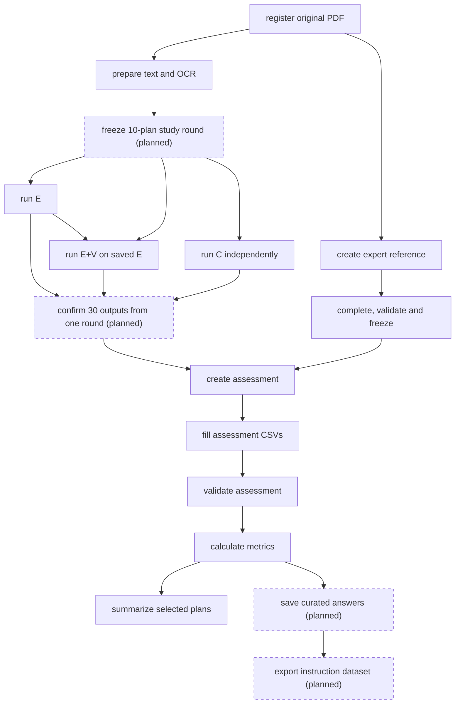

# heat adaptation LLM dataset

this research project examines how heat adaptation experts and open-weight large language models (LLMs) can be paired to build an extraction workflow. it will share practical lessons from the expert judgments, model outputs, and revisions involved in developing that workflow. the project uses open-weight models through hugging face.

the workflow extracts heat adaptation actions from government and public agency plans into structured records with supporting quotations. it supports **E** (extraction) and **E+V** (extraction + verification): **inkling 2 small** extracts, and **deepseek v4.1 flash 1017** checks and revises that exact saved extraction.

development **C** (collaboration) uses **glm-5.3-flash** to coordinate inkling and deepseek as two flexible workers. it assigns extraction or checking tasks, runs independent assignments in parallel, and assembles one complete JSON answer from the prepared plan. see the [coordinator](prompts/coordinator.md) and [worker](prompts/worker.md) prompts. all three configurations have completed development runs on freetown and paris under earlier settings. the latest shared guidance, C prompts, and budgets still need live checks and expert assessment. all three models use hugging face with deepinfra as the fixed host. expert-curated answers will also support a pilot instruction dataset for possible future fine-tuning.

for setup and commands, see [getting started](#getting-started) and the [command line interface](#command-line-interface).

## study design

use freetown and paris as the two initial development plans to build the workflow, refine prompts, and check execution. add eight plans, then compare E, E+V, and C across all ten, including fresh runs on the original two. the final comparison requires 30 successful configuration outputs from one frozen study round. each configuration keeps its own fixed settings across all plans; E+V revises that round's selected E.

select the first successful E, linked V, and independent C within the round. execution failures can be retried with unchanged settings. any change to the frozen workflow supersedes the entire round and requires all three configurations to run again across all ten plans, including previously successful runs. earlier outputs remain development history. failure counts are not a study outcome; runtime and tokens describe the selected successful runs.

controls for frozen rounds, full restarts, and completeness remain to be implemented. current commands support development pilots. record which plans informed refinements and experts' prior exposure when interpreting the final ten-plan comparison.

## workflow overview



repeat the model stages for every plan in the round, using the same selected preparation for that plan. E+V revises the selected E output; C starts independently. code the expert reference from the original PDF before viewing model outputs where no prior exposure has occurred; record existing exposure and freeze the form before assessment. dashed boxes mark planned tooling; activity matching, scoring, evidence review, and curation remain expert judgments.

## project documents

- [design document](DESIGN.md): research objectives, methods, action fields, coding rules, and evaluation measures.
- [implementation document](IMPLEMENTATION.MD): current implementation, file directory, and technical details.
- [structured change log](CHANGELOG.md): meaningful decisions, changes, failures, and lessons from development.

## extracted records

each model answer contains three components:

| component | contents |
| --- | --- |
| `plan_data.metadata` | document and jurisdiction metadata. |
| `plan_data.actions` | one record per specific heat adaptation activity across the plan. |
| `plan_issues.issues` | grouped concerns, uncertainties, conflicts, source gaps, and possible omissions. |

every action has nine fields: `action_id`, `action`, `action_type`, `action_status`, `action_location`, `action_recipient`, `action_cost`, `action_benefit`, and `evidence`. costs and benefits are recorded within their associated action. evidence uses exact continuous quotations and physical PDF page positions counted from 1. the [field definitions and coding rules](DESIGN.md#appendix-dataset-coding-rules-and-evaluation) specify permitted values and missing information.

issues retain stable IDs and origins through verification and curation. curated-answer validation supports E/V and C identities with expert resolutions. after assessment, experts will prepare separate curated answers; saved model outputs remain the evidence for comparison. instruction export remains to be built. see the [remaining work](IMPLEMENTATION.MD#next-implementation-steps).

## getting started

complete setup from the project directory before running extraction.

### set up the environment

install [uv](https://docs.astral.sh/uv/getting-started/installation/), then run:

```bash
uv sync --locked
```

this installs the locked dependencies and CLI in `.venv`. `uv run` uses that environment automatically.

### set up OCR

initialize the english OCR models once:

```bash
uv run --locked python -c "from document_tools import EasyOcrReader; EasyOcrReader(download_models=True)"
```

models are cached in `.cache/easyocr/`. PDF preparation and OCR run locally; LLM inference uses the hugging face API. registration and preparation do not require an API token.

### API access

create a hugging face access token with inference providers permission and add account credits or billing. all hosted models use this token.

in bash or zsh, run the following command, paste the token when the terminal waits, and press enter. token input is hidden:

```bash
read -r -s HF_TOKEN
```

then export it for commands in that terminal session:

```bash
export HF_TOKEN
```

run model commands in that same terminal session. the program reads `HF_TOKEN` from the environment; it does not load `.env` files automatically or save authentication headers.

### compatibility check

use these checks when changing models, hosting, or the generation schema. earlier passes apply to the tested settings; checks are not needed for each plan.

each command makes up to five **paid requests** using fictional inputs to check JSON schemas, output limits, and a tool round trip. it stops at the first failure.

inkling:

```bash
uv run --locked python -m huggingface_check --check-tools
```

deepseek:

```bash
uv run --locked python -m huggingface_check \
  --model deepseek-ai/DeepSeek-V4.1-Flash-1017 \
  --check-tools
```

glm coordinator model:

```bash
uv run --locked python -m huggingface_check \
  --model zai-org/GLM-5.3-Flash \
  --check-tools
```

all three models have passed these five checks with the shared project schema. `--model` changes only the diagnostic model, retaining the base extractor profile's settings and task. it does not run the verifier or collaboration workflow, or test the coordinator prompt. reports go to `artifacts/huggingface_checks/`. see the [diagnostic details](IMPLEMENTATION.MD#compatibility-diagnostics); compatibility does not establish full-plan or coordination quality.

for project-schema failures, `--isolate-project-schema` instead runs up to two paid request variants. use it without `--check-tools`; both results are saved even if one fails.

### coordination check

test glm's coordinator interfaces with a fictional plan and controlled worker replies:

```bash
uv run --locked python -m collaboration_check
```

makes up to eight **paid coordinator request attempts**, capped at 16,384 output tokens each and 15 minutes overall. inkling and deepseek are not called. the check covers delegation, a corrected worker error, an unresolved source conflict, and the final JSON. records go to `artifacts/collaboration_checks/`. this is a small interface diagnostic; expert assessment is needed to establish full-plan quality. see the [diagnostic details](IMPLEMENTATION.MD#coordination-diagnostic).

## command line interface

the usual workflow is `add_plan` → `prepare_plan` → `run_extract_mode` → `run_verify_mode`. use `list_profiles` for model choices and limits, `list_plans` for IDs and preparation paths, and `update_plan_data` for metadata corrections. run commands from the project directory.

`run_collaboration_mode` starts independently from a prepared development plan. see the [collaboration protocol](IMPLEMENTATION.MD#collaboration-c) for the coordinator and worker design.

### add_plan: register a PDF

[screen eligibility](DESIGN.md#eligible-plans), then replace the example path and collection details:

```bash
uv run --locked heat-adaptation-llm-dataset add_plan \
  "$HOME/Downloads/your-plan.pdf" \
  --title "your plan title" \
  --source-url "https://example.org/your-plan.pdf" \
  --date-accessed "YYYY-MM-DD" \
  --study-set development
```

keep the supplied PDF outside `data/raw/`. registration copies it there and assigns a plan ID; identical PDFs reuse the existing record. study sets are `development` for the initial two plans, `comparison` for the additional eight, and `expansion` (deferred). final-round membership will include both initial study sets; its controls are still planned.

### prepare_plan: prepare page text

```bash
uv run --locked heat-adaptation-llm-dataset prepare_plan plan_0001
```

uses native text and selective OCR; add `--no-ocr` to skip recognition. each attempt creates a new preparation folder. check the text against the PDF: `ready` means no automatic flags, `ready_with_gaps` needs review, and `failed` needs investigation before extraction. see [preparation details](IMPLEMENTATION.MD#prepare-text-automatically-investigate-gaps-with-tools).

### run_extract_mode: extract actions

use the exact preparation path shown by `list_plans`:

```bash
uv run --locked heat-adaptation-llm-dataset run_extract_mode plan_0001 \
  --source-path data/processed/plan_0001/preparation_01/preparation.json \
  --profile inkling2_small_hf_extractor \
  --purpose development
```

### run_verify_mode: verify a saved extraction

```bash
uv run --locked heat-adaptation-llm-dataset run_verify_mode plan_0001 \
  --profile deepseek_v4_1_flash_1017_hf_verifier \
  --purpose development
```

uses the latest validated, successful eligible E run and its exact preparation. add `--input-run-id run_extract_0008` to select a particular E run, including for consistent prompt comparisons. these are development defaults; final-round verification will use that round's selected E.

each configuration has 90 minutes overall, with the final 30 minutes protected for its final answer. for E+V, the complete E run and V investigation share the first 60 minutes; an E run exceeding 60 minutes cannot enter this timed workflow. human waiting between commands is excluded, and final generation can begin earlier when investigation finishes. see [time allowances](IMPLEMENTATION.MD#configuration-time-allowance).

### run_collaboration_mode: coordinate three models

```bash
uv run --locked heat-adaptation-llm-dataset run_collaboration_mode plan_0001 \
  --source-path data/processed/plan_0001/preparation_01/preparation.json \
  --profile glm5_3_flash_hf_collaboration \
  --purpose development
```

calls all three models without importing E/V or expert answers and saves a new `run_collaboration_NNNN/` folder. only development plans are enabled. `--config-path` selects C bindings (default `configs/collaboration.json`); `--model-config-path` selects model profiles (default `configs/profiles.json`).

### create_expert_reference: start an expert form

```bash
uv run --locked heat-adaptation-llm-dataset create_expert_reference plan_0001 \
  --prepared-by "your name or study ID"
```

saves `data/expert_references/plan_0001/expert_reference.json` with collection metadata, instructions, one guided action, and one expert issue. repeat `--prepared-by` for multiple experts. replace `TODO:` guidance or remove unused blanks while coding from the original PDF. complete the form before viewing model outputs where no prior exposure has occurred, and record existing exposure. requires registration only, makes no API calls, and refuses to overwrite an existing form.

### edit_expert_reference: add or remove records

```bash
uv run --locked heat-adaptation-llm-dataset edit_expert_reference \
  --plan-id plan_0001 --add-action
```

select the reference with `--plan-id` and choose one operation:

| flag | operation |
| --- | --- |
| `--add-action` / `--add-issue` | append a guided blank with the next numbered ID. |
| `--remove-action` / `--remove-issue` | remove the highest-ID untouched blank of that kind. |
| `--remove-action action_0002` / `--remove-issue issue_0002` | remove that exact record, including an edited one. |

partially filled records are preserved by default removal. remove or relink associated issues before removing their action. the editor maintains `id_counters` so deleted IDs are not reused; keep these counters when coding the form directly. editing checks the registered original PDF and draft links, permits unfinished guidance, and saves atomically. the editor refuses changes to frozen references. no model or OCR calls are made.

### validate_expert_reference: check an expert form

```bash
uv run --locked heat-adaptation-llm-dataset validate_expert_reference plan_0001
```

checks JSON, fields, source links, action/issue IDs and links, and physical page bounds against the original PDF. unfinished `TODO:` guidance fails validation. omitted `plan_issues` is checked as an empty issue list; empty action types or evidence require a linked expert issue. reference issues originate with `expert`; resolved ones name `expert` as resolver. these are separate from model-output issues. validation is read-only and makes no API calls. an empty action list can still pass; experts establish accuracy and completeness.

### freeze_expert_reference: preserve the assessment reference

after completing and reviewing the form, freeze it before recording judgments:

```bash
uv run --locked heat-adaptation-llm-dataset freeze_expert_reference plan_0001 \
  --frozen-by "your name or study ID"
```

validates the form, writes `reference_freeze.json` beside it, and prints the reference's SHA-256 fingerprint. the freeze records the exact reference and original PDF fingerprints, source details, reviewer, and UTC time. repeat `--frozen-by` for multiple reviewers. keep the reference fingerprint with manual judgments. editor changes and resets are blocked; `validate_expert_reference` detects later reference or source changes. no model or OCR calls are made.

freezing records the reviewer's confirmation of readiness for assessment. experts establish completeness and accuracy; freezing does not enable formal comparison.

### create_assessment: prepare manual review CSVs

after completing and freezing the reference:

```bash
uv run --locked heat-adaptation-llm-dataset create_assessment plan_0001 \
  --reviewer "your name or study ID"
```

creates a new `data/assessments/plan_0001/assessment_NNNN/` with `metadata.json`, `action_scores.csv`, `output_review.csv`, and `verifier_resolutions.csv`. copies reference/output context and leaves judgment fields blank. no model or OCR calls are made. development plans only; formal comparison remains disabled.

| flag | use |
| --- | --- |
| `--reviewer` | required; repeat for multiple reviewers. |
| `--extractor-run-id` | select E; default latest validated, successful development E. |
| `--verifier-run-id` | select V; default latest successful V linked to E. supplying V alone selects its saved E. |
| `--collaboration-run-id` | select C; default latest successful C using the selected preparation. |
| `--notes` | optional review context. |

E/V must be linked, and all three outputs must use the same preparation. an explicit invalid ID fails without fallback. if the latest E has no eligible V, select an earlier E explicitly or complete verification. the command prints and records the chosen IDs; later runs do not replace them.

these are development forms. final assessments will use the selected outputs from one complete ten-plan round; current commands do not enforce round membership or the 30-output requirement.

read the instructions in `metadata.json` before editing the CSVs. confirm activity grouping, match by meaning, and fill scores, support/evidence judgments, V-resolution confirmations, and reasons.

### validate_assessment: check review files and saved inputs

```bash
uv run --locked heat-adaptation-llm-dataset validate_assessment plan_0001 \
  --assessment-id assessment_0001
```

checks the selected runs, source and frozen-reference fingerprints, CSV fields, ID links, copied context, and review coverage. reports unfinished judgments separately from invalid data, with review status for each configuration. blank cells and `undetermined` judgments remain pending; `[]` explicitly records an omitted reference activity and requires a zero score.

each reference activity needs one scoring row per configuration. output groups may combine splits/duplicates or separate bundled activities, but must cover every output record. V confirmations must cover exactly the eligible claims in the selected E/V pair. an unsupported activity cannot have adequate evidence.

returns 0 for valid files, including unfinished reviews, or 1 for invalid files. add `--require-complete` to also return 1 when manual judgments or group coverage remain pending. the command changes no files, calculates no metrics, and makes no model or OCR calls. validation checks consistency; experts establish whether judgments are correct.

### calculate_metrics: save per-plan results

```bash
uv run --locked heat-adaptation-llm-dataset calculate_metrics plan_0001 \
  --assessment-id assessment_0001
```

validates the selected assessment and creates a new `metrics_NNNN/` folder inside it. saves `results.json`, a `summary.csv` with one row per measure/configuration or paired change, exact assessment-file copies under `assessment_inputs/`, and calculation code under `code/`. earlier calculations and assessment files are preserved. results identify selected runs, the frozen reference, reviewers, and input/code fingerprints. no model or OCR calls are made. development plans only.

calculates action score percentage, unsupported activity count, adequate-evidence percentage, open issues, runtime, tokens, V resolutions, and E+V minus E / C minus E+V changes. E+V includes E plus V costs; C uses its complete elapsed time and each coordinator/worker call once. output denominators use reviewed activity groups.

pending judgments leave their measures `null`; missing measurements are unavailable, and percentages with zero denominators are not applicable. each measure retains its status, reason, unit, and applicable counts/denominator. add `--require-complete` to require finished manual review before saving. successful publication returns 0; invalid inputs or a failed strict check return 1. current exports retain unused null failure fields outside the study outcomes. experts still establish source correctness.

### summarize_metrics: combine selected plans

select one exact saved calculation per plan:

```bash
uv run --locked heat-adaptation-llm-dataset summarize_metrics \
  --result data/assessments/plan_0001/assessment_0001/metrics_0001 \
  --result data/assessments/plan_0002/assessment_0001/metrics_0001
```

repeat `--result` for each selected plan; at least one is required. a calculation's `results.json` path is also accepted. duplicate plans, incompatible methods, and damaged packages fail. the command checks package fingerprints and recalculates measures from archived judgments against the preserved reference, source, and runs. later edits to live assessment CSVs do not replace the selected review.

percentages use the mean of available per-plan percentages, giving each plan equal weight. paired summaries average within-plan changes using plans with both required values. activity/issue counts and successful-run resource use are labelled totals by configuration; confirmed/claimed V resolutions use the same contributing plans for both counts. each measure lists contributors and exclusions. pending or unavailable observations remain explicit.

development summaries can include a subset of plans. the final study summary will require all ten plans from one complete round; current checks do not enforce the full sample or frozen workflow identity across plans.

creates a new `data/reports/summary_NNNN/` containing `summary.json`, `summary.csv`, selected result copies under `inputs/<plan_id>/`, and calculation code under `code/`. the CSV includes per-plan and aggregate rows, retaining units, counts/denominators, status, and plan lists. earlier reports and source packages are preserved. returns 0 on publication or 1 on validation/publication failure. no model or OCR calls are made. development summaries only; formal comparison remains disabled.

### list_profiles: find model choices and limits

```bash
uv run --locked heat-adaptation-llm-dataset list_profiles
```

shows selectable E, V, and C profiles, their run commands, models, and limits. C's coordinator and workers appear under its shared profile. makes no API calls and needs no token. use `--config-path` for another model profile file and `--collaboration-config-path` for another C binding file.

### list_plans: find IDs and preparation paths

```bash
uv run --locked heat-adaptation-llm-dataset list_plans
```

shows ID, study set, title, preparation status, and path; plans without preparation show `not_prepared`.

### update_plan_data: correct metadata

```bash
uv run --locked heat-adaptation-llm-dataset update_plan_data plan_0001 --title "corrected plan title"
```

editable fields are `--title`, `--source-url`, `--date-accessed`, and `--study-set`. omitted fields and saved preparations/runs are preserved. development assignments are fixed; other study-set changes require no saved model work.

### run options and results

use `--purpose development` for development plans. E/V also allow `exploratory` for investigations outside the final comparison. final-round execution remains disabled. planned controls must admit both initial and additional plans, freeze workflow/source identities, require 30 selected outputs, and reject superseded or mixed rounds. existing purpose and disclosure restrictions remain in effect until those controls are implemented.

| optional flag | use |
| --- | --- |
| `--retry-of-run-id <failed_run_id>` | link a new attempt to a failed run. verifier retries retain their original E input; C retries use the same preparation. omit for a new development repeat. |
| `--config-path <path>` | E/V: select another project-relative profile file; default `configs/profiles.json`. |
| `--project-root "/path/to/project"` | any command: select another project directory; place after the command name. |

current ceilings include final generation:

| allowance | E | E+V | C |
| --- | --- | --- | --- |
| model/API requests | 25 | 50: 25 per stage | 25 shared |
| document-tool calls | 25 | 50: 25 per stage | 75: 25 per agent |

each configuration has a 31,457,280 estimated-token ceiling; within E+V, V deducts its linked E estimates. request and tool counts are separate: one API reply can request several tools. see the [complete settings table](IMPLEMENTATION.MD#current-configuration-settings) and [request budgeting](IMPLEMENTATION.MD#configuration-request-and-token-allowances) for details.

a submitted document tool exceeding its complete-request deadline fails E, V, or C and stops further model requests. failure evidence and any late reply are preserved. ordinary source/OCR problems can return error evidence for the model to assess.

model commands print their saved status and available report paths. each invocation preserves a new folder under `runs/<plan_id>/`: `run_extract_NNNN/`, `run_verify_NNNN/`, or `run_collaboration_NNNN/`. all apply final JSON validation and quotation checks; source accuracy requires expert review. see [E/V execution](IMPLEMENTATION.MD#saved-execution) and [C execution](IMPLEMENTATION.MD#saved-c-execution) for files and failure handling.

press ctrl+c to request cancellation. a record left `running` needs inspection after confirming the process has stopped; recovery and retries are manual.

### help and checks

```bash
uv run --locked heat-adaptation-llm-dataset --help
uv run --locked heat-adaptation-llm-dataset run_verify_mode --help
uv run --locked pytest -q
```

add `--help` to any command for all flags. exit codes: 0 success, 1 failure, 2 invalid arguments, 130 model-run cancellation. automated model tests use controlled replies; real OCR tests require cached models. passing checks does not establish factual accuracy.

back up `data/raw/`, `data/processed/`, `data/expert_references/`, `data/assessments/`, `data/reports/`, `runs/`, and `artifacts/` separately; all are excluded from git. keep selected metric packages with their reports. see the [file directory](IMPLEMENTATION.MD#1-file-directory).
