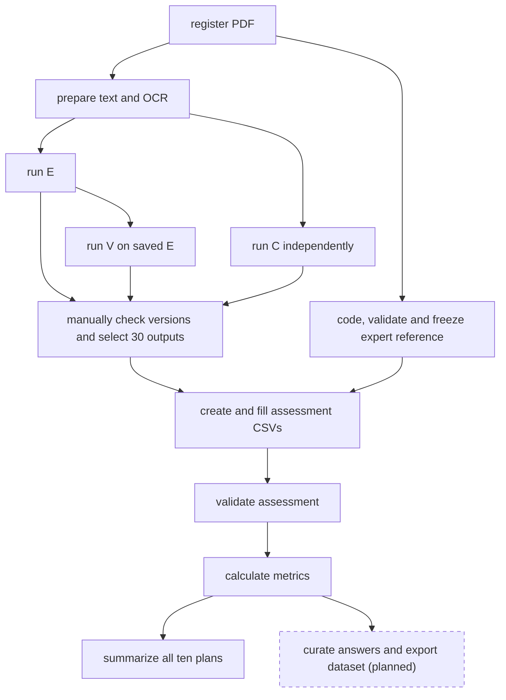

# heat adaptation LLM dataset

a research workflow pairing heat adaptation experts with large language models (LLMs) to extract actions from government plans, compare three configurations, and build a pilot instruction dataset.

| configuration | how it works |
| --- | --- |
| **E** | inkling 2 small extracts actions and evidence. |
| **E+V** | deepseek v4.1 flash 1017 checks and revises that exact saved E. |
| **C** | glm-5.3-flash coordinates inkling and deepseek as flexible workers, independently of E/E+V. |

LLM inference uses hugging face with deepinfra as the fixed host. PDF preparation, optical character recognition (OCR), and document tools run locally.

[study design](DESIGN.md) · [implementation details](IMPLEMENTATION.MD) · [development history](CHANGELOG.md)

## study design

1. develop and refine the workflow on two plans.
2. add eight plans and fix the final code, prompts, settings, and preparations.
3. run all ten plans through E, E+V, and C: **30 successful outputs**.
4. compare each plan's outputs against one shared expert reference.

track versions and selected run IDs manually. use the first successful E, its first successful linked V, and the first successful independent C under the final settings. retry execution failures with unchanged settings. **any workflow change requires rerunning all three configurations across all ten plans.** preserve earlier runs as development history.

the final comparison includes the original two plans. record which plans informed refinement and experts' prior output exposure. runtime and tokens cover the selected successful runs; failure counts are outside the study outcomes. see the [research protocol](DESIGN.md#workflow-and-comparison).

## current status

development E, E+V, and C runs have completed on both initial plans. the latest shared guidance, C prompts, and budgets still need live checks and expert review.

reference tools, assessment CSVs, validation, metrics, and cross-plan summaries are implemented. execution/assessment support for the additional plans and instruction export remain to be completed. **current command examples are for development:** comparison execution remains blocked in code. manual tracking needs no study-round creation or freezing command.

## workflow overview



repeat the model stages for all ten plans using each plan's selected preparation. experts code references from the original PDF, record prior exposure, and freeze the forms before scoring. the software saves the records; final version and sample checks are manual.

## getting started

### environment and OCR

install [uv](https://docs.astral.sh/uv/getting-started/installation/), then run from the project directory:

```bash
uv sync --locked
uv run --locked python -c "from document_tools import EasyOcrReader; EasyOcrReader(download_models=True)"
```

the second command initializes english OCR models in `.cache/easyocr/`. registration, preparation, and expert review tools need no API token.

### API access

create a hugging face token with inference providers permission and account credits/billing. in bash or zsh, enter the token without displaying it:

```bash
read -r -s HF_TOKEN
export HF_TOKEN
```

run model commands in that terminal. the program reads the environment; it does not load `.env` automatically or save authentication headers.

when changing models, hosting, or generation schemas, use the [compatibility diagnostics](IMPLEMENTATION.MD#compatibility-diagnostics). the separate [coordination diagnostic](IMPLEMENTATION.MD#coordination-diagnostic) checks GLM with controlled workers. both make paid requests and are separate from study runs.

## command line interface

use `--help` on any command for its full flags. `--project-root "/path/to/project"` selects another project directory. the examples below use the installed development profiles.

### 1. register and prepare

[screen eligibility](DESIGN.md#eligible-plans), then replace the example details:

```bash
uv run --locked heat-adaptation-llm-dataset add_plan \
  "$HOME/Downloads/your-plan.pdf" \
  --title "your plan title" \
  --source-url "https://example.org/your-plan.pdf" \
  --date-accessed "YYYY-MM-DD" \
  --study-set development

uv run --locked heat-adaptation-llm-dataset prepare_plan plan_0001
uv run --locked heat-adaptation-llm-dataset list_plans
```

keep the supplied PDF outside `data/raw/`; registration preserves a copy and assigns its ID. identical PDFs reuse the record. registry sets identify the initial two plans as `development` and the additional eight as `comparison`; both belong in the final analysis.

preparation uses native text and selective OCR; `--no-ocr` skips recognition. check the PDF when status is `ready_with_gaps`, and investigate `failed` before extraction. `ready` means automatic checks passed, with source accuracy still requiring review.

### 2. run E, E+V, and C

copy the exact preparation path from `list_plans`:

```bash
uv run --locked heat-adaptation-llm-dataset run_extract_mode plan_0001 \
  --source-path data/processed/plan_0001/preparation_01/preparation.json \
  --profile inkling2_small_hf_extractor --purpose development

uv run --locked heat-adaptation-llm-dataset run_verify_mode plan_0001 \
  --profile deepseek_v4_1_flash_1017_hf_verifier --purpose development \
  --input-run-id run_extract_0001

uv run --locked heat-adaptation-llm-dataset run_collaboration_mode plan_0001 \
  --source-path data/processed/plan_0001/preparation_01/preparation.json \
  --profile glm5_3_flash_hf_collaboration --purpose development
```

replace example run IDs with those printed by your commands. V uses the selected E and its preparation; C reads the prepared plan independently. `list_profiles` shows available bindings. each invocation creates a new run folder; `--retry-of-run-id` links a failed attempt. verifier retries keep their E input.

current configurations have a 90-minute ceiling with 30 minutes reserved for the final answer. E+V shares its allowance between E and V. see the [settings table](IMPLEMENTATION.MD#current-configuration-settings) for request, tool, token, and time limits.

### 3. complete and freeze the expert reference

```bash
uv run --locked heat-adaptation-llm-dataset create_expert_reference plan_0001 \
  --prepared-by "your name or study ID"
```

edit `data/expert_references/plan_0001/expert_reference.json` from the PDF. replace `TODO:` guidance and remove unused blanks. complete it before viewing outputs where no prior exposure has occurred; record existing exposure. repeat identity flags for multiple experts/reviewers.

```bash
uv run --locked heat-adaptation-llm-dataset edit_expert_reference \
  --plan-id plan_0001 --add-action
uv run --locked heat-adaptation-llm-dataset validate_expert_reference plan_0001
uv run --locked heat-adaptation-llm-dataset freeze_expert_reference plan_0001 \
  --frozen-by "your name or study ID"
```

the editor can add actions/issues or remove an untouched blank or explicit ID. it preserves stable IDs and rejects frozen forms. freezing records the exact reference/PDF fingerprints and reviewer confirmation. experts establish accuracy and completeness. see [reference tools](IMPLEMENTATION.MD#expert-reference-creation--implemented).

### 4. create and fill the assessment

```bash
uv run --locked heat-adaptation-llm-dataset create_assessment plan_0001 \
  --reviewer "your name or study ID" \
  --extractor-run-id run_extract_0001 \
  --verifier-run-id run_verify_0001 \
  --collaboration-run-id run_collaboration_0001
```

requires a completed frozen reference and three compatible successful outputs. use explicit run IDs from the manual run log for the final comparison. development defaults select the latest eligible E, linked V, and same-preparation C. invalid explicit IDs fail without fallback.

a new `data/assessments/<plan_id>/assessment_NNNN/` contains:

| file | what to do |
| --- | --- |
| `metadata.json` | generated selections, fingerprints, reviewers, and instructions; read before editing CSVs. |
| `action_scores.csv` | match reference activities to output IDs; enter 0/0.5/1 scores and reasons. |
| `output_review.csv` | confirm activity groups; enter support/evidence judgments and reasons. |
| `verifier_resolutions.csv` | confirm whether V resolved every concern in each eligible E issue. |

judgment cells start blank. combine split/duplicate output records and separate bundled activities before judging them. IDs are local to each dataset. scoring and curation remain expert work.

### 5. validate and calculate

```bash
uv run --locked heat-adaptation-llm-dataset validate_assessment plan_0001 \
  --assessment-id assessment_0001 --require-complete
uv run --locked heat-adaptation-llm-dataset calculate_metrics plan_0001 \
  --assessment-id assessment_0001 --require-complete
```

validation checks inputs, CSV fields/links, copied context, and coverage. `--require-complete` requires settled manual review; omit it to inspect valid partial assessments. pending judgments remain `null`, missing measurements are unavailable, and zero-denominator percentages are not applicable.

calculation saves a new `metrics_NNNN/` containing `results.json`, `summary.csv`, exact assessment inputs, and code snapshots. it preserves earlier calculations and makes no model/OCR calls.

### 6. summarize selected plans

```bash
uv run --locked heat-adaptation-llm-dataset summarize_metrics \
  --result data/assessments/plan_0001/assessment_0001/metrics_0001 \
  --result data/assessments/plan_0002/assessment_0001/metrics_0001
```

this two-plan example is a pilot. repeat `--result` once for each of the ten final plans, selecting exact saved calculations from the consistent final run set. check sample completeness manually.

reports go to `data/reports/summary_NNNN/`. they contain JSON/CSV, selected result copies, and code snapshots. percentages use equal-weight per-plan means; paired changes use plans with both measures. counts/resources are labelled totals. every aggregate lists contributing and excluded plans. see [reporting details](IMPLEMENTATION.MD#cross-plan-summaries--implemented-for-development).

## records, checks, and remaining work

use `update_plan_data <plan_id> --help` for collection-metadata corrections and `list_profiles` for model/binding choices.

outputs contain plan metadata, activity records with exact quotations/physical PDF pages, and grouped review issues. [DESIGN.md](DESIGN.md#appendix-dataset-coding-rules-and-evaluation) defines the fields and coding rules. source accuracy requires expert review.

```bash
uv run --locked heat-adaptation-llm-dataset --help
uv run --locked pytest -q
```

exit codes are 0 success, 1 failure, 2 invalid arguments, and 130 model-run cancellation. ctrl+c preserves available evidence; inspect a leftover `running` record after confirming the process has stopped. retries and recovery are manual.

back up `data/raw/`, `data/processed/`, `data/expert_references/`, `data/assessments/`, `data/reports/`, `runs/`, and `artifacts/`; all are excluded from git.

next work: support study execution/assessment for the additional plans, align unused failure fields in current exports, pilot expert review, and build instruction export. see the [implementation roadmap](IMPLEMENTATION.MD#next-implementation-steps).
