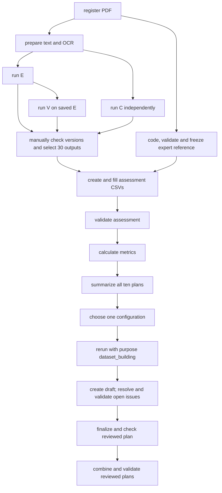

# heat adaptation LLM dataset

a research workflow pairing heat adaptation experts with large language models (LLMs) to extract actions from government plans, compare three configurations, and build a heat adaptation action dataset.

| configuration | how it works |
| --- | --- |
| **extractor (E)** | inkling 2 small extracts actions and evidence. |
| **extractor + verifier (E+V)** | deepseek v4.1 flash 1017 checks and revises that exact saved E. |
| **collaboration (C)** | glm-5.3-flash coordinates inkling and deepseek as flexible workers, independently of E/E+V. |

LLM inference uses hugging face with deepinfra as the fixed host. PDF preparation, optical character recognition (OCR), and document tools run locally.

[study design](DESIGN.md) · [implementation details](IMPLEMENTATION.MD) · [project history](CHANGELOG.md)

[workflow](#workflow-overview) · [comparison commands](#1-register-and-prepare) · [dataset building](#7-run-the-chosen-configuration-for-dataset-building)

## study design

1. develop and refine the workflow on two plans.
2. add eight plans and fix the final code, prompts, settings, and preparations.
3. run all ten plans through E, E+V, and C: **30 successful outputs**.
4. compare each plan's outputs against one shared expert reference.

track versions and selected run IDs manually. use the first successful E, its first successful linked V, and the first successful independent C under the final settings. retry execution failures with unchanged settings. **any workflow change requires rerunning all three configurations across all ten plans.** preserve earlier runs as history.

all ten plans belong to one comparison sample. study runs use `--purpose comparison` (the default); the manual log identifies the final study selections. record which plans informed refinement and experts' prior output exposure. runtime and tokens cover the selected successful runs; metrics and reports omit failure counts. see the [research protocol](DESIGN.md#workflow-and-comparison).

## current status

the core software path is implemented, including references, assessments, metrics, plan review, combined assembly, and completed-output validation. early E, E+V, and C runs completed on both initial plans under earlier settings.

remaining work is real-plan pilots of current guidance/settings, expert assessment, the final ten-plan run set, and dataset building. instruction export and fine-tuning are deferred. see the [remaining work](IMPLEMENTATION.MD#next-steps).

## workflow overview



## getting started

### environment and OCR

install [uv](https://docs.astral.sh/uv/getting-started/installation/), then run from the project directory:

```bash
uv sync --locked
uv run --locked python -c "from document_tools import EasyOcrReader; EasyOcrReader(download_models=True)"
```

the second command initializes english OCR models in `.cache/easyocr/`. registration, preparation, and expert review tools need no API token.

### existing data layout

| data location | contents |
| --- | --- |
| `data/source_pdfs/`, `data/prepared_plans/` | shared original PDFs and prepared text/OCR/images. |
| `data/comparison/` | expert references, assessment CSVs/metrics, and cross-plan reports. |
| `data/dataset_building/review_drafts/` | editable plan data and issue decisions. |
| `data/dataset_building/reviewed_plans/` | clean reviewed plans and separate review evidence. |
| `data/dataset_building/heat_action_datasets/dataset_NNNN/` | preserved combined dataset versions. |

<details>
<summary>older checkouts: migrate storage</summary>

preview and apply migration before creating new preparations:

```bash
uv run --locked heat-adaptation-llm-dataset migrate_data_layout --dry-run
uv run --locked heat-adaptation-llm-dataset migrate_data_layout
```

migration preserves evidence/fingerprints, updates registry paths, and checks historical runs. old recorded paths remain readable. occupied destinations or symlinks stop migration; interrupted moves can resume. use one writer.

</details>

### API access

create a hugging face token with inference providers permission and account credits/billing. in bash or zsh, enter the token without displaying it:

```bash
read -r -s HF_TOKEN
export HF_TOKEN
```

run model commands in that terminal. the program reads the environment; it does not load `.env` automatically or save authentication headers.

when changing models, hosting, or generation schemas, use the [compatibility diagnostics](IMPLEMENTATION.MD#compatibility-diagnostics). the separate [coordination diagnostic](IMPLEMENTATION.MD#coordination-diagnostic) checks GLM with controlled workers. both make paid requests and are separate from study runs.

## command line interface

use `--help` on any command for its full flags. `--project-root "/path/to/project"` selects another project directory. the examples below use the configured model profiles.

### 1. register and prepare

[screen eligibility](DESIGN.md#eligible-plans), then replace the example details:

```bash
uv run --locked heat-adaptation-llm-dataset add_plan \
  "$HOME/Downloads/your-plan.pdf" \
  --title "your plan title" \
  --source-url "https://example.org/your-plan.pdf" \
  --date-accessed "YYYY-MM-DD"

uv run --locked heat-adaptation-llm-dataset prepare_plan plan_0001
uv run --locked heat-adaptation-llm-dataset list_plans
```

keep the supplied PDF outside `data/source_pdfs/`; registration preserves a copy and assigns its ID. identical PDFs reuse the record. new plans default to the `comparison` sample; use `--study-set expansion` for later dataset building beyond the ten plans. archived labels remain readable without rewriting their files.

preparation uses native text and selective OCR; `--no-ocr` skips recognition. check the PDF when status is `ready_with_gaps`, and investigate `failed` before extraction. `ready` means automatic checks passed, with source accuracy still requiring review.

### 2. run E, E+V, and C

copy the exact preparation path from `list_plans`:

```bash
uv run --locked heat-adaptation-llm-dataset run_extract_mode plan_0001 \
  --source-path data/prepared_plans/plan_0001/preparation_01/preparation.json \
  --profile inkling2_small_hf_extractor

uv run --locked heat-adaptation-llm-dataset run_verify_mode plan_0001 \
  --profile deepseek_v4_1_flash_1017_hf_verifier \
  --input-run-id run_extract_0001

uv run --locked heat-adaptation-llm-dataset run_collaboration_mode plan_0001 \
  --source-path data/prepared_plans/plan_0001/preparation_01/preparation.json \
  --profile glm5_3_flash_hf_collaboration
```

replace example run IDs with those printed by your commands. V uses the selected E and its preparation; C reads the prepared plan independently. `list_profiles` shows available bindings. each invocation creates a new run folder; `--retry-of-run-id` links a failed attempt with the same purpose. verifier retries keep their E input.

all runs default to comparison. once settings are final, rerun all ten plans, including both initial plans. use `--input-run-id` for the E selected in your manual log. record selected IDs, versions, and prior exposure; the comparison label alone does not identify final study results.

current configurations have a 90-minute ceiling with 30 minutes reserved for the final answer. E+V shares its allowance between E and V. see the [settings table](IMPLEMENTATION.MD#current-configuration-settings) for request, tool, token, and time limits.

### 3. complete and freeze the expert reference

```bash
uv run --locked heat-adaptation-llm-dataset create_expert_reference plan_0001
```

edit `data/comparison/expert_references/plan_0001/expert_reference.json` from the PDF. replace `TODO:` guidance and remove unused blanks. complete it before viewing outputs where no prior exposure has occurred; record existing exposure. reference and review commands do not capture names or study IDs.

```bash
uv run --locked heat-adaptation-llm-dataset edit_expert_reference \
  --plan-id plan_0001 --add-action
uv run --locked heat-adaptation-llm-dataset validate_expert_reference plan_0001
uv run --locked heat-adaptation-llm-dataset freeze_expert_reference plan_0001
```

the editor can add actions/issues or remove an untouched blank or explicit ID. it preserves stable IDs and rejects frozen forms. freezing records exact reference/PDF fingerprints, time, and readiness confirmation. experts establish accuracy and completeness. see [reference tools](IMPLEMENTATION.MD#expert-reference-creation--implemented).

### 4. create and fill the assessment

```bash
uv run --locked heat-adaptation-llm-dataset create_assessment plan_0001 \
  --extractor-run-id run_extract_0001 \
  --verifier-run-id run_verify_0001 \
  --collaboration-run-id run_collaboration_0001
```

requires a frozen reference and compatible successful comparison outputs. omitted IDs select the latest eligible E, linked V, and same-preparation C. use the manual log's three IDs/versions for final assessment. invalid explicit IDs fail without fallback; dataset-building runs are ineligible. assessments have no purpose flag or metadata field.

a new `data/comparison/assessments/<plan_id>/assessment_NNNN/` contains:

| file | what to do |
| --- | --- |
| `metadata.json` | generated selections, fingerprints, notes, and instructions; read before editing CSVs. |
| `action_scores.csv` | match reference activities to output IDs; enter 0/0.5/1 scores and reasons. |
| `output_review.csv` | confirm activity groups; enter support/evidence judgments and reasons. |
| `verifier_resolutions.csv` | confirm whether V resolved every concern in each eligible E issue. |

judgment cells start blank. combine split/duplicate output records and separate bundled activities before judging them. IDs are local to each dataset. scoring and curation remain expert work.

### 5. validate and calculate

```bash
uv run --locked heat-adaptation-llm-dataset validate_assessment plan_0001 \
  --assessment-id assessment_0001 --require-complete
uv run --locked heat-adaptation-llm-dataset calculate_metrics plan_0001 \
  --assessment-id assessment_0001 --require-complete
```

validation checks inputs, CSV fields/links, copied context, and coverage. `--require-complete` requires settled manual review; omit it to inspect valid partial assessments. pending judgments remain `null`, missing measurements are unavailable, and zero-denominator percentages are not applicable.

calculation saves a new `metrics_NNNN/` containing `results.json`, `summary.csv`, exact assessment inputs, and code snapshots. it preserves earlier calculations and makes no model/OCR calls.

### 6. summarize selected plans

```bash
uv run --locked heat-adaptation-llm-dataset summarize_metrics \
  --result data/comparison/assessments/plan_0001/assessment_0001/metrics_0001 \
  --result data/comparison/assessments/plan_0002/assessment_0001/metrics_0001
```

this two-plan example shows the selection syntax. repeat `--result` once for each of the ten final plans, selecting exact calculations from the recorded final run set. check sample completeness manually.

reports go to `data/comparison/reports/summary_NNNN/`. they contain JSON/CSV, selected result copies, and code snapshots. percentages use equal-weight per-plan means; paired changes use plans with both measures. counts/resources are labelled totals. every aggregate lists contributing and excluded plans. see [reporting details](IMPLEMENTATION.MD#cross-plan-summaries--implemented).

### 7. run the chosen configuration for dataset building

after the study, choose one configuration and rerun it with `--purpose dataset_building`, including the original ten plans. plan membership and run purpose are separate:

| plan's study set | allowed run purposes |
| --- | --- |
| `comparison` | `comparison` (default) or `dataset_building` |
| `expansion` | `dataset_building` only; supply the flag explicitly. |

for example, if E+V is chosen:

```bash
uv run --locked heat-adaptation-llm-dataset run_extract_mode plan_0001 \
  --source-path data/prepared_plans/plan_0001/preparation_01/preparation.json \
  --profile inkling2_small_hf_extractor --purpose dataset_building

uv run --locked heat-adaptation-llm-dataset run_verify_mode plan_0001 \
  --profile deepseek_v4_1_flash_1017_hf_verifier \
  --input-run-id run_extract_0009 --purpose dataset_building
```

replace `run_extract_0009` with the new E ID. V requires an E with the same purpose; omitting the ID selects the latest eligible E of that purpose. C accepts the same purpose flag. the flag changes eligibility and saved records; prompts, settings, and execution checks follow the selected configuration.

these runs stay under `runs/<plan_id>/` and cannot enter comparison assessments. the original ten plans keep `study_set: comparison`; additional plans use `expansion`. record the chosen configuration/settings manually; assembly checks that the selected reviews share a recorded workflow version.

### 8. review open issues and finalize each plan

```bash
uv run --locked heat-adaptation-llm-dataset create_review_draft plan_0001 \
  --configuration E+V --run-id run_verify_0007
```

replace the example ID with the dataset-building V run. `--configuration` is required; choose `E`, `E+V`, or `C`. omit `--run-id` to use the latest eligible successful run of that configuration. an invalid explicit ID fails without fallback.

edit `data/dataset_building/review_drafts/plan_0001/review_0001/review_draft.json`. check each remaining open issue against the PDF, correct `plan_data`, and mark the issue `resolved` with `resolved_by: expert` and a nonblank `resolution`. keep original issue IDs, origins, descriptions, and types. model-resolved concerns retain their statuses/resolutions; additional concerns can use new expert-origin issues. keep action links valid after merges or removals.

```bash
uv run --locked heat-adaptation-llm-dataset validate_review_draft plan_0001 \
  --review-id review_0001 --require-complete
uv run --locked heat-adaptation-llm-dataset finalize_reviewed_plan plan_0001 \
  --review-id review_0001
```

omit `--require-complete` while editing to distinguish valid drafts from finished reviews. finalization requires all issues addressed and saves a completed folder under `data/dataset_building/reviewed_plans/<plan_id>/<review_id>/`:

| file | contents |
| --- | --- |
| `reviewed_plan.json` | clean `metadata` and `actions`; no issue objects. |
| `review_record.json` | source/final-file fingerprints, completion time, issue history, and `review_scope: open_issues_only`. |
| `review_draft.json`, `source_run.json` | exact reviewed draft and original selected run. |

review covers remaining open issues; omissions and model-resolved concerns are outside its scope. completed files are preserved; further work starts a new draft. interrupted finalization can resume only if its saved files match the same reviewed bytes.

recheck a completed plan and its preserved review/source evidence with:

```bash
uv run --locked heat-adaptation-llm-dataset validate_reviewed_plan plan_0001 \
  --review-id review_0001
```

### 9. combine completed reviewed plans

```bash
uv run --locked heat-adaptation-llm-dataset build_heat_action_dataset \
  --review data/dataset_building/reviewed_plans/plan_0001/review_0001 \
  --review data/dataset_building/reviewed_plans/plan_0011/review_0001
```

replace these paths with exact completed review folders, or their `reviewed_plan.json` files. repeat `--review` once per plan; there is no latest-review default. both original comparison and expansion plans are eligible. duplicate plan IDs or identical original PDFs are rejected.

all selections must use the same E, E+V, or C configuration and recorded workflow version: model/provider settings, prompts, tools, budgets, software-version information, and archived code. E+V checks both linked stages; C includes its workers and shared limits. plan-specific sources, run IDs, timings, and Git observations may differ. see [compatibility details](IMPLEMENTATION.MD#combined-action-datasets--implemented).

each build creates `data/dataset_building/heat_action_datasets/dataset_NNNN/`:

| file or folder | contents |
| --- | --- |
| `heat_action_dataset.json` | `schema_version` and a `plans` list; each plan has `plan_id`, `metadata`, and `actions`. no issue objects. |
| `dataset_contents.json` | exact selected review/run IDs, common workflow, counts, fingerprints, and build time. |
| `inputs/` | exact completed review files, including their separate issue history. |
| `artifacts/code/` | preserved assembly code and schemas. |

a new build preserves earlier versions, including their exact review selections. adding or revising a plan requires another explicit build. incomplete saves have no contents record and cannot load as finished datasets; their version numbers remain reserved. keep the original source runs and supporting evidence backed up. assembly makes no model calls and retains the open-issues-only review scope.

recheck a saved version, its selected review copies, common workflow, and fingerprints with:

```bash
uv run --locked heat-adaptation-llm-dataset validate_heat_action_dataset dataset_0001
```

both completed-output validators are read-only: they report errors without editing files or creating versions. finalization and assembly also run these checks when publishing outputs.

## records, checks, and remaining work

use `update_plan_data <plan_id> --help` for collection-metadata corrections and `list_profiles` for model/binding choices.

[DESIGN.md](DESIGN.md#appendix-dataset-coding-rules-and-evaluation) defines output fields and coding rules. source accuracy requires expert review.

successful E/V/C records must match their preserved final candidates, and archived code must match its startup checksums. loading also checks saved C input against its source/settings and compares actual UTC times. failed attempts retain available evidence. these checks establish file consistency; experts assess source accuracy.

```bash
uv run --locked heat-adaptation-llm-dataset --help
uv run --locked pytest -q
```

exit codes are 0 success, 1 failure, 2 invalid arguments, and 130 model-run cancellation. ctrl+c preserves available evidence; inspect a leftover `running` record after confirming the process has stopped. retries and recovery are manual.

back up `data/source_pdfs/`, `data/prepared_plans/`, `data/comparison/`, `data/dataset_building/`, `runs/`, and `artifacts/`; all are excluded from git.
